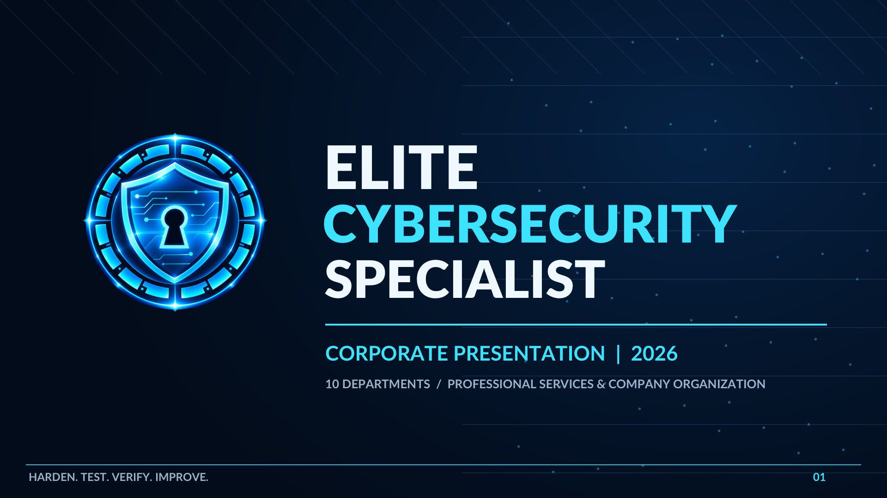
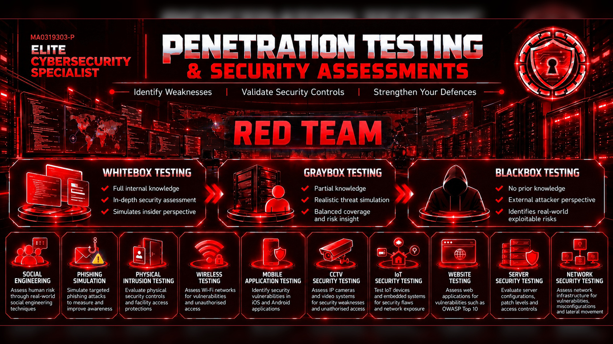
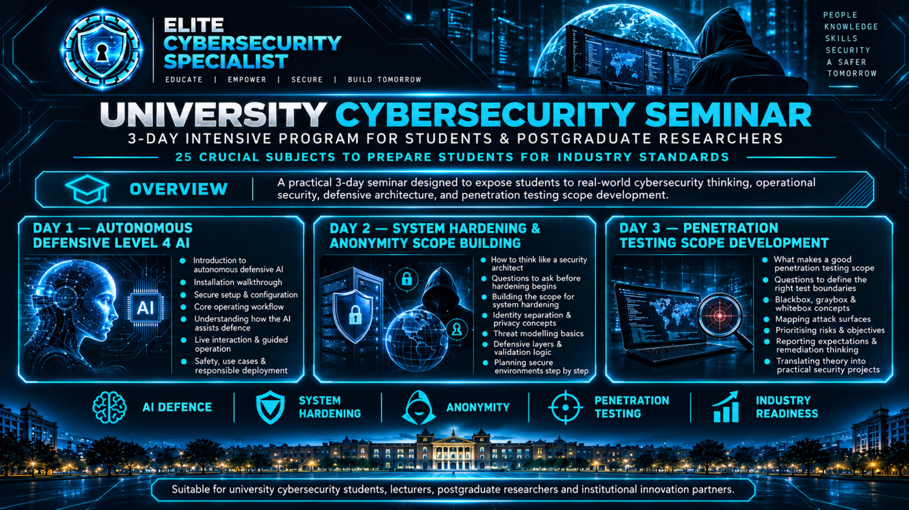
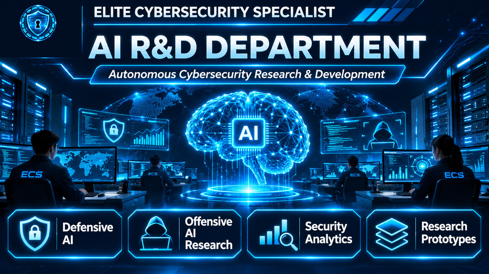
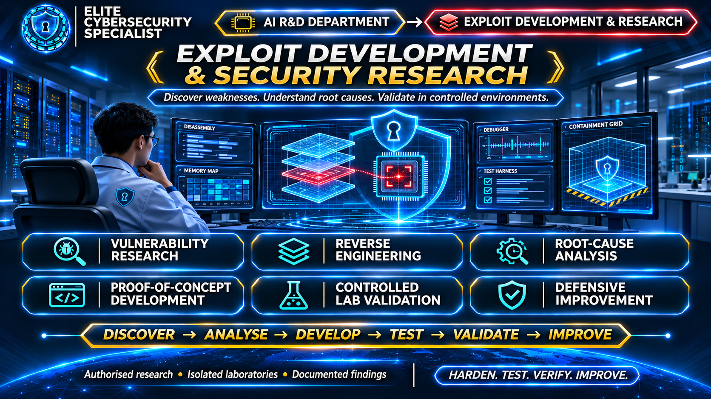
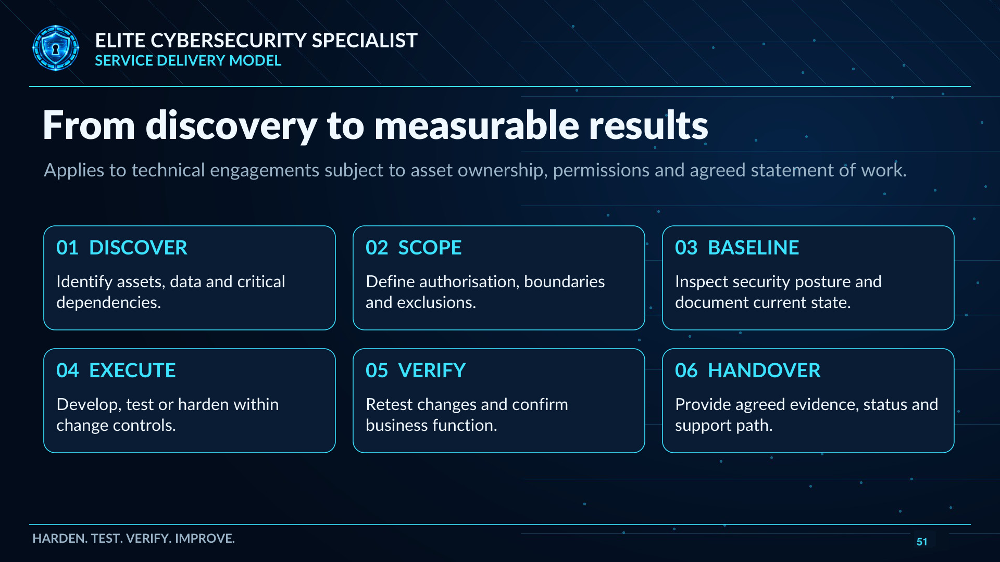

<h1 align="center">ELITE CYBERSECURITY SPECIALIST</h1>

<strong>Company Profile | November 2026</strong>

  <a href="pdf/ECS_Company_Profile_2026-11.pdf"><strong>Download Company Profile (PDF)</strong></a>
  &nbsp;·&nbsp;
  <a href="https://github.com/elite-cybersecurity-specialist">GitHub Projects</a>
  &nbsp;·&nbsp;
  <a href="https://elite-cybersecurity-specialist.blogspot.com/">Official ECS Blog</a>

> **HARDEN. TEST. VERIFY. IMPROVE.**

## About ECS

Established in Malaysia in 2024, Elite Cybersecurity Specialist (ECS) serves private-sector organisations, businesses and enterprises. Our professional services cover defensive security engineering, authorised offensive assessments, secure development, cybersecurity education and applied AI research.

We work with a discreet network of highly skilled cybersecurity specialists and ethical hackers whose identities remain confidential. Our engagements start with the client's systems, critical services and operating constraints, and advance through agreed changes and verification to a documented handover.

[Organisation & Leadership](#organisational-hierarchy) · [Professional Services](#professional-services) · [Company Organization](#company-organization) · [Field Operations](#field-operations) · [How We Deliver](#how-we-deliver) · [Sales & Pricing](#sales--pricing) · [Contact](#connect-with-elite-cybersecurity-specialist)

## Our 10 Departments + Field Operations

Five departments deliver professional services and five support company operations. **Field Operations is a separate support function led by the Field Manager, reporting directly to the CEO.**

| Professional Services | Company Organization |
| --- | --- |
| [01 · Elite Defence](#01-elite-defence-department) | [06 · Governance Risk and Compliance — under HR][grc] |
| [02 · Elite Offensive](#02-elite-offensive-department) | [07 · Internal IT][internal-it] |
| [03 · Software & Website Development](#03-software--website-development-department) | [08 · Marketing & Sales (Pre Sales)][pre-sales] |
| [04 · Education & Training](#04-education--training-department) | [09 · Post Sales][post-sales] |
| [05 · AI R&D](#05-ai-rd-department) | [10 · HR & Finance][hr-finance] |

### Organisational Hierarchy

[![ECS organisational hierarchy: Chairman, CEO and four directly reporting functions — HR & Finance Manager, CTO, BDM and Field Manager. Ten departments are supported by independent Field Operations. Solid lines show reporting; dotted lines show coordination and material sharing.][org-chart]][org-chart]

**Chairman → CEO → HR & Finance Manager, CTO, Business Development Manager (BDM) and Field Manager.**

| Reporting function | Leadership and departments | Responsibility |
| --- | --- | --- |
| HR, Finance & Governance | HR & Finance Manager → Department 10. GRC (06) reports through HR. | People, administration, financial control, company records and GRC coordination. |
| Technical & Professional Services | CTO → Internal IT & Technical Services Manager → Departments 01, 02, 03, 04, 05 and 07 → Team Leaders → Staff. | Defensive engineering, offensive assessments, secure development, education, AI research and ECS internal technology. |
| Business Development | BDM → Marketing & Sales / Pre Sales (08) and Post Sales (09) → Team Leaders → Staff. | Growth, client relationships, commercial coordination, support communication and renewals. |
| Field Operations | Field Manager → sourcing, logistics, equipment, physical-security and clearance/access-support personnel. | Independent deployment support, working closely with RED TEAM, BLUE TEAM and AI R&D. |

**Solid chart lines show reporting. Dotted lines show coordination and material sharing; they do not create extra management authority.**

#### Leadership and Accountability

| Position | Reports to | Main responsibilities |
| --- | --- | --- |
| Chairman | Strategic oversight | Set long-term direction; review performance, major investments and leadership accountability; support strategic relationships. |
| Chief Executive Officer (CEO) | Chairman | Lead company strategy, budgets, performance and customer commitments; assess technical capability, engineering quality and delivery risk; coordinate the four functional heads. |
| HR & Finance Manager | CEO | Oversee staffing, payroll, budgets, billing and administration; supervise GRC through HR; coordinate financial approvals and supplier payments with Field Operations. |
| Chief Technology Officer (CTO) | CEO | Lead technical strategy, research priorities and engineering standards; review complex architecture, testing and evidence; coordinate technical resources and specialist technology requirements. |
| Internal IT & Technical Services Manager | CTO | Allocate specialists; manage workloads, schedules and dependencies; coordinate delivery, verification, reporting and technical escalations; give Field Operations the crew, location and equipment requirements. |
| Business Development Manager (BDM) | CEO | Lead opportunities, partnerships, customer relationships and renewals; oversee Pre Sales and Post Sales; coordinate approved scope, quotations and commercial follow-up. |
| Field Manager | CEO | Lead sourcing and field support; prepare equipment, travel, accommodation, food, physical security and access arrangements; coordinate RED TEAM, BLUE TEAM, AI R&D and Finance requirements. |

**ECS leadership requirement: a CEO without technical cybersecurity skills cannot sustain the company. Strong technical competence is essential.**

Team Leaders assign daily work, guide staff, check quality, monitor progress and escalate issues to the responsible manager. Staff and specialists complete assigned work, follow agreed procedures, document results and report technical or operational issues promptly.

## Professional Services

### 01. Elite Defence Department

**Defensive System Hardening.** ECS assesses existing configuration, maps applicable controls, applies approved changes and verifies both enforcement and service operation. Scope can include Linux and Windows servers, operating systems, cloud, virtualisation, websites, APIs, databases, endpoints, networks, Wi-Fi, CCTV and IoT. Ongoing work can cover integrity monitoring, controlled updates, encrypted backups and recovery checks.

**Custom Secure Android Phones.** ECS configures GrapheneOS on supported Google Pixel devices for sensitive communications and administration. The agreed setup can cover verified installation, bootloader relocking, app separation, credentials, USB settings, approved encrypted apps and recovery arrangements. [Secure Android illustration][secure-android]

**Anonymity & Privacy Architecture.** ECS designs hardened operator devices, separate administration identities, restricted infrastructure access and protected communication routes. The design can use a protected public edge and separate origin, or a Tor-only service for an agreed private workflow. We validate access boundaries and routing against the threat model. [Public internet and payment architecture][public-architecture] · [Tor-only architecture][tor-architecture]

[Department overview][defence-overview] · [ECS Hardening Challenge](https://github.com/elite-cybersecurity-specialist/hardening-challenge)

### 02. Elite Offensive Department

**RED TEAM Operations & Advanced Penetration Testing.** ECS agrees written authorisation, test boundaries and objectives with the asset owner. RED TEAM exercises simulate relevant adversaries and validate attack paths, security controls, detection and response. Penetration testing discovers and validates exploitable weaknesses, records their impact, and gives the client remediation and retest priorities.

| Assessment | Scope and approach |
| --- | --- |
| Black Box | External assessment with little or limited internal information. |
| Grey Box | Targeted testing with selected access, credentials or system information. |
| White Box | Deeper assessment with approved access to architecture, source code or privileged context. |
| RED TEAM | Objective-led adversary simulation using threat-informed techniques, including relevant MITRE ATT&CK techniques. |
| Purple Team | Offensive and defensive specialists run scoped exercises together to improve detection and response. |

Agreed scopes can include web and mobile applications, APIs, authentication and access controls, networks, wireless, cloud, identity infrastructure, CCTV and IoT. Any social engineering, phishing simulation or physical access testing is scoped with the owner.

[Department overview][offensive-overview] · [Testing methods][testing-methods] · [ECS Penetration Testing](https://github.com/elite-cybersecurity-specialist/penetration-testing)

### 03. Software & Website Development Department

**Cybersecurity System Development.** ECS designs and develops applications, custom software, APIs, databases, integrations and security automation. Delivery covers requirements and data flows, architecture, secure coding, dependency review, functional and security testing, deployment and handover.

**Custom Secure Websites.** ECS plans user roles, authentication, sessions and data handling together with deployment. Projects can include corporate sites, online stores, portals, dashboards and custom web applications. Scope can include origin hardening, edge protection, hosted payment integrations, logging, backups and recovery.

[Department overview][development-overview] · [Custom secure website types][website-types] · [ECS System Development](https://github.com/elite-cybersecurity-specialist/system-development) · [ECS Custom Secure Websites](https://github.com/elite-cybersecurity-specialist/custom-secure-websites)

### 04. Education & Training Department

ECS offers university seminars, practical workshops and corporate training. The proposed three-day university programme covers 25 planned subjects, with scope and materials agreed with each institution.

| Day | Focus |
| --- | --- |
| 1 | Autonomous Defensive AI, guided operation and safeguards in a controlled environment. |
| 2 | System hardening and privacy, including asset discovery, threat models and applicable controls. |
| 3 | Authorised penetration-testing scope, Black/Grey/White Box concepts, reporting and remediation. |

[Department overview][education-overview] · [Three-day seminar outline][seminar-outline]

### 05. AI R&D Department

ECS researches defensive automation, threat intelligence, security analytics and agent-assisted testing. Research includes developing prototypes, evaluating controls and assessing operational suitability against the requirements of each engagement.

| Research project | Focus |
| --- | --- |
| [Battle-Hardened AI](https://github.com/elite-cybersecurity-specialist/battle-hardened-ai) | Autonomous defensive analysis, validation, security decisions and adaptable controls. |
| [Battle Offensive AI](https://github.com/elite-cybersecurity-specialist/battle-offensive-ai) | Agent-assisted research into authorised assessment workflows, test selection and evidence validation. |

[Department overview][ai-overview] · [AI research portfolio][ai-portfolio]

#### Exploit Development & Security Research

Exploit Development & Security Research is a research function **within the AI R&D Department**. It supports understanding, validation and defensive improvement.

| Research capability | Purpose |
| --- | --- |
| Vulnerability research | Study weaknesses and affected components in scoped research environments. |
| Reverse engineering | Analyse software behaviour, interfaces and implementation details. |
| Root-cause analysis | Explain why a weakness exists and which trust boundary or control failed. |
| Proof-of-concept development | Develop controlled demonstrations to validate research hypotheses. |
| Controlled lab validation | Record conditions, observations, repeatability and research limitations. |
| Defensive improvement | Translate findings into mitigations, detection opportunities and retest guidance. |

Outputs include documented findings, controlled research demonstrations, technical analysis and practical defensive recommendations. This function remains part of AI R&D.

## Company Organization

| Department | Responsibility |
| --- | --- |
| [06 · Governance Risk and Compliance Department][grc] | Reports under HR within HR & Finance. Coordinates policies, risk registers, compliance tracking, third-party risk, audit evidence, exceptions and approvals, with engineering evidence from technical departments. |
| [07 · Internal IT Department][internal-it] | Runs ECS employee systems, access, the corporate network, asset lifecycle, backups and the internal service desk. |
| [08 · Marketing & Sales Department (Pre Sales)][pre-sales] | Reports through the BDM. Qualifies enquiries, runs discovery and coordinates technical review, proposals, approved presentations and handover to delivery. |
| [09 · Post Sales Department][post-sales] | Reports through the BDM. Owns customer communication and coordinates support, technical escalation, field visits, agreed maintenance, service follow-up and renewals. |
| [10 · HR & Finance Department][hr-finance] | Manages staffing, administration, payroll, budgets, billing, financial approvals and supplier-payment records. GRC reports through HR; Field Operations leads specialist sourcing and deployment logistics. |

### Field Operations

**Field Operations is a separate support function led by the Field Manager, who reports directly to the CEO.** It supports RED TEAM and BLUE TEAM deployments and collaborates closely with AI R&D.

The Field Manager coordinates specialist tools, hardware, software, licences, supplier evaluations and rentals; crew transport, drivers, hotels, food and water; equipment storage and protection; physical-security personnel; site passes, equipment-entry approvals and required clearances.

| Supporting position | Responsibility |
| --- | --- |
| Sourcing Officers | Identify suitable suppliers, compare products and obtain purchase or rental quotations. |
| Logistics Coordinators | Arrange crew transport, accommodation, food, deliveries and deployment schedules. |
| Equipment Custodians | Store, inspect, issue, track, maintain and recover equipment. |
| Physical Security Personnel | Protect assigned personnel, premises and equipment within agreed arrangements. |
| Clearance / Access Coordinator | Prepare and track clearances, site permissions, passes and equipment approvals. |

**Field support flow:** Requirements → Sourcing & Costs → Access Arrangements → Readiness Check → Field Support → Return & Records.

Technical teams define the crew, location, timing and equipment requirements. Field Operations compares resources and coordinates arrangements; Finance handles the required financial approvals and supplier payments. The readiness check covers equipment, licences, travel, accommodation, security contacts and approval status. After deployment, equipment is recovered, condition is checked, costs are reconciled and issue/return records are retained.

The client, site owner or relevant approving party grants access. The Field Manager coordinates and tracks permissions, including any client-approved alternative access explicitly included in an exercise scope.

### Materials and Cross-Team Coordination

Pre Sales and Post Sales coordinate the distribution of approved company, service, customer and training materials to relevant teams, including Education & Training. Technical specialists provide subject expertise and instruction. Material sharing and operational collaboration follow the dotted chart lines; formal reporting remains as shown by the solid lines.

### Security Standards and Company Credentials

| Area | Engineering references |
| --- | --- |
| Configuration hardening | Applicable CIS Controls and Benchmarks, DISA STIG/SRG guidance and vendor safeguards. |
| Governance and access | NIST CSF 2.0, NIST SP 800-53, NIST SP 800-207, and ISO/IEC 27001 and 27002 principles. |
| Application security | OWASP Top 10, ASVS and API Security, NIST SSDF (SP 800-218), and CISA Secure by Design. |
| Threat-informed assessment | MITRE ATT&CK for relevant techniques and attack paths. |

The corporate roadmap includes the Sdn. Bhd. transition and work toward applicable NACSA licensing, CyberSecurity Malaysia PTSP certification, CREST company accreditation and ISO/IEC 27001 certification. [NACSA licensing](https://www.nacsa.gov.my/application-licensing.php) · [CyberSecurity Malaysia PTSP scheme](https://iscb.cybersecurity.my/index.php/certification/management-system-certification/penetration-test/how-to-apply-2)

## How We Deliver

**Discover → Scope → Baseline → Execute → Verify → Handover**

The engagement begins with asset ownership, critical services, dependencies and agreed boundaries. ECS then records the baseline, implements or tests within change controls, and verifies the agreed security and service outcomes before handover.

### What Clients Receive

- Agreed scope, asset inventory, baseline and applicable security requirements.
- Documented changes, verification results, validated findings and practical remediation priorities.
- Before-and-after evidence, accepted exceptions, retest results and remaining risk where relevant.
- Operational guidance, ownership and support arrangements for maintenance, monitoring, backups, recovery or incident response as agreed.

Private-sector clients include private banks, family offices, payment providers, gaming businesses, privacy-sensitive professionals and enterprise cybersecurity teams. ECS also offers cybersecurity seminars for universities.

## Sales & Pricing

ECS publishes indicative selling ranges in Malaysian Ringgit (RM). Each quotation defines assets, scope, deliverables, exclusions and acceptance criteria. Hardware, third-party services, travel and applicable taxes are excluded unless expressly included.

| Service | Indicative ECS rate |
| --- | ---: |
| Linux or Windows Server hardening, standard scope | From RM5,000 per server |
| Extended production server hardening | RM15,000–40,000+ |
| Supported Google Pixel / GrapheneOS setup | RM5,000 per device for engineering |
| Standard website or application hardening | From RM10,000 per site |
| Black Box web application testing | RM8,000–20,000 |
| Grey Box web application testing | RM10,000–25,000 |
| White Box web application testing | RM12,000–30,000 |
| RED TEAM adversary simulation | RM50,000–150,000+ |
| Purple Team exercise | RM60,000–150,000+ |
| Custom secure website development | RM15,000–50,000+ |
| Software or system development | RM30,000–150,000+ |
| Cybersecurity seminar or workshop | RM3,000–12,000 |

[Full pricing tables, engineering scope and commercial terms (PDF)](pdf/ECS_Company_Profile_2026-11.pdf)

## Connect with Elite Cybersecurity Specialist

  

**Yuhisern Navaratnam** — Cybersecurity Engineer 
**Elite Cybersecurity Specialist** | Malaysia 
**SSM:** 202403184091 (MA0319303-P)

- [Email](mailto:Yuhisern@protonmail.com)
- [WhatsApp](https://wa.me/60172791717)
- [GitHub](https://github.com/elite-cybersecurity-specialist)
- [LinkedIn](https://www.linkedin.com/in/yuhisern/)
- [ECS LinkedIn](https://www.linkedin.com/company/elite-cybersecurity-specialist/)
- [TikTok](https://www.tiktok.com/@yuhisern)
- [X](https://x.com/yuhisern)

**HARDEN. TEST. VERIFY. IMPROVE.**

[org-chart]: assets/ecs-2026/source-images/latest-pdf-key-pages/04-org-chart-approved-2-6-2.png
[defence-overview]: assets/ecs-2026/slides/01-professional-services/01-elite-defence/11-elite-defence-department-overview.jpg
[secure-android]: assets/ecs-2026/slides/01-professional-services/01-elite-defence/14-custom-secure-android-phones.jpg
[public-architecture]: assets/ecs-2026/slides/01-professional-services/01-elite-defence/16-cloudflare-and-payment-architecture.jpg
[tor-architecture]: assets/ecs-2026/slides/01-professional-services/01-elite-defence/17-tor-only-private-architecture.jpg
[offensive-overview]: assets/ecs-2026/slides/01-professional-services/02-elite-offensive/18-elite-offensive-department-overview.jpg
[testing-methods]: assets/ecs-2026/slides/01-professional-services/02-elite-offensive/20-testing-methods-black-grey-white-purple.jpg
[development-overview]: assets/ecs-2026/slides/01-professional-services/03-software-website-development/22-software-website-development-overview.jpg
[website-types]: assets/ecs-2026/slides/01-professional-services/03-software-website-development/24-custom-secure-websites.jpg
[education-overview]: assets/ecs-2026/slides/01-professional-services/04-education-training/26-education-training-department-overview.jpg
[seminar-outline]: assets/ecs-2026/slides/01-professional-services/04-education-training/28-three-day-seminar-outline.jpg
[ai-overview]: assets/ecs-2026/slides/01-professional-services/05-ai-research-development/29-ai-research-development-overview.jpg
[ai-portfolio]: assets/ecs-2026/slides/01-professional-services/05-ai-research-development/31-ai-research-portfolio.jpg
[grc]: assets/ecs-2026/slides/02-company-organization/06-governance-risk-compliance/33-governance-risk-compliance-overview.jpg
[internal-it]: assets/ecs-2026/slides/02-company-organization/07-internal-it/38-internal-it-department-overview.jpg
[pre-sales]: assets/ecs-2026/slides/02-company-organization/08-marketing-sales-pre-sales/41-marketing-sales-pre-sales-overview.jpg
[post-sales]: assets/ecs-2026/slides/02-company-organization/09-post-sales/44-post-sales-department-overview.jpg
[hr-finance]: assets/ecs-2026/slides/02-company-organization/10-hr-finance/47-hr-finance-department-overview.jpg
