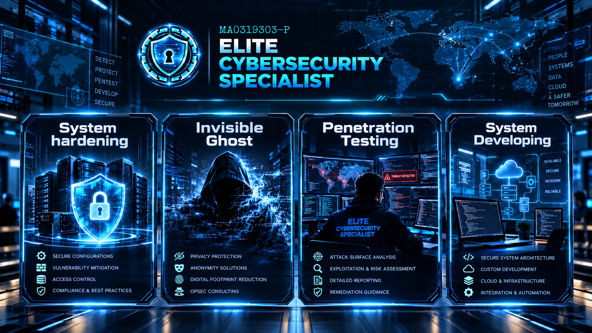
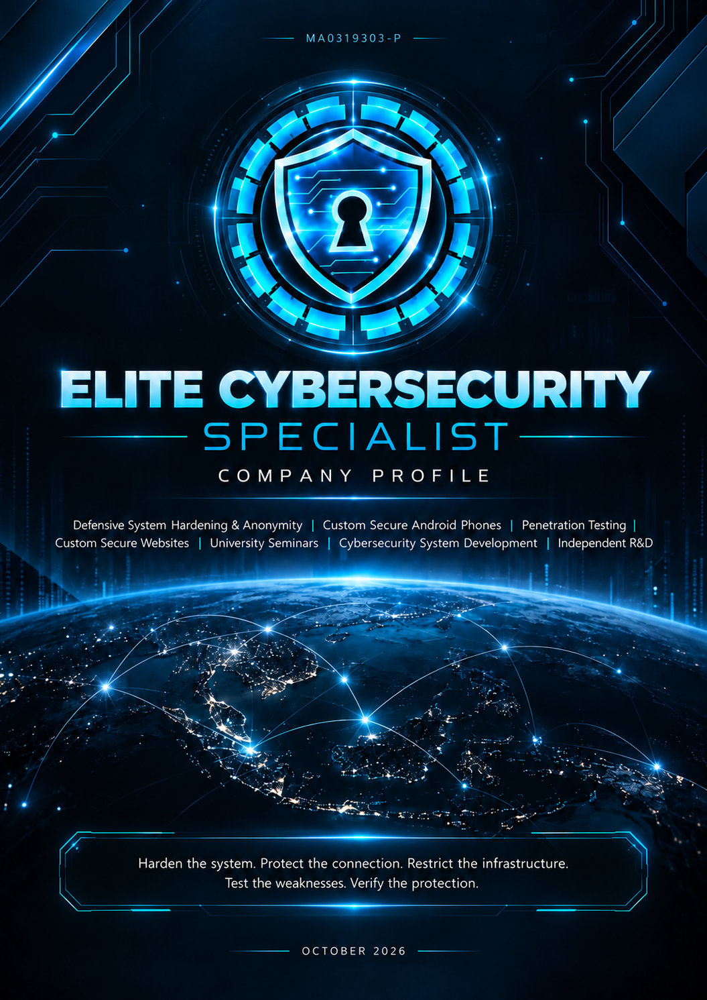
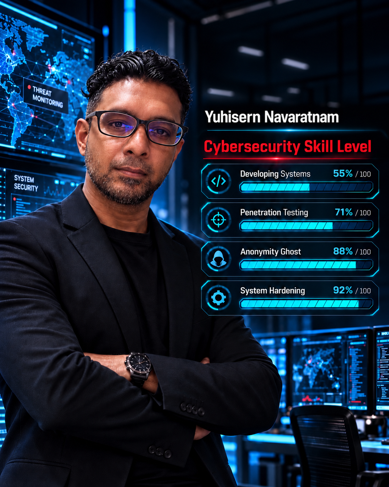
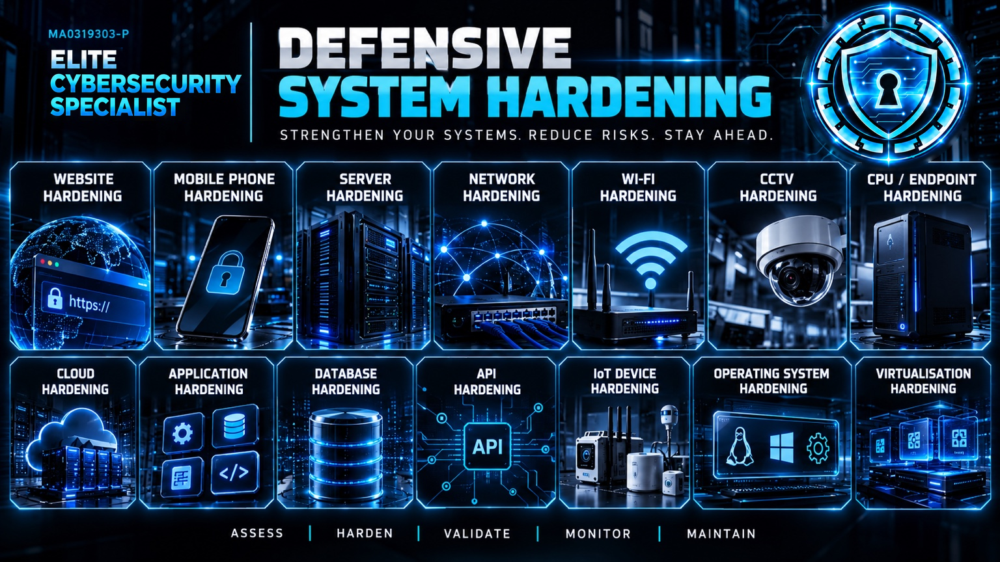
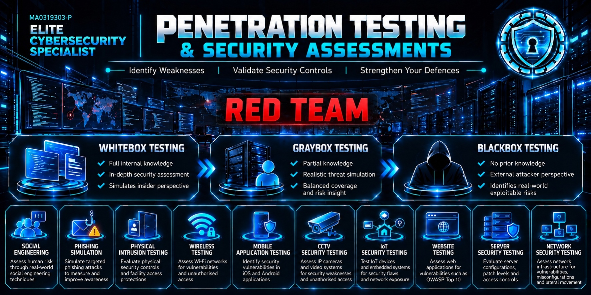
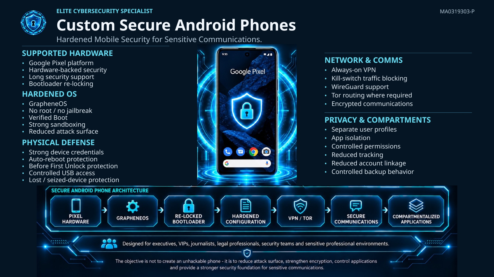
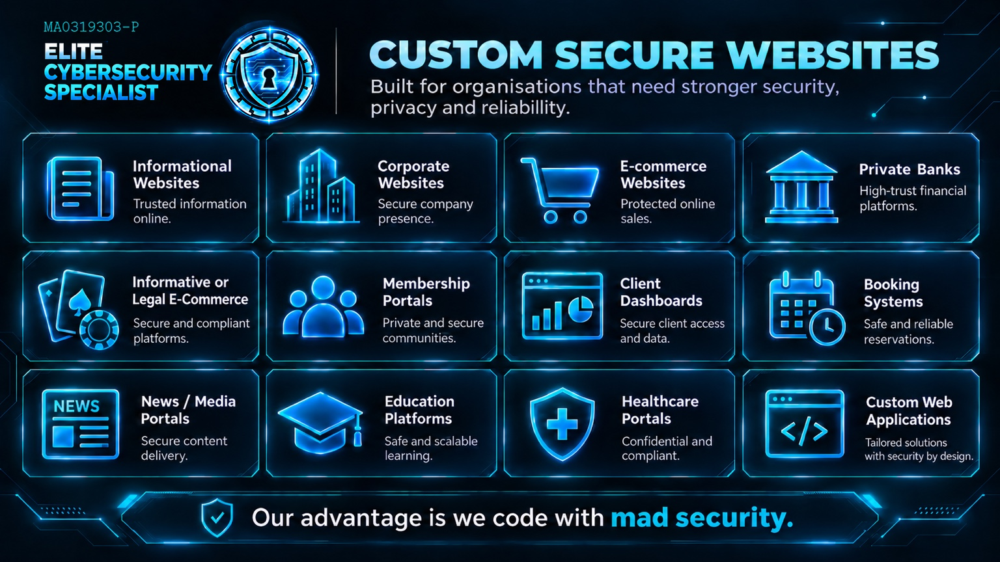
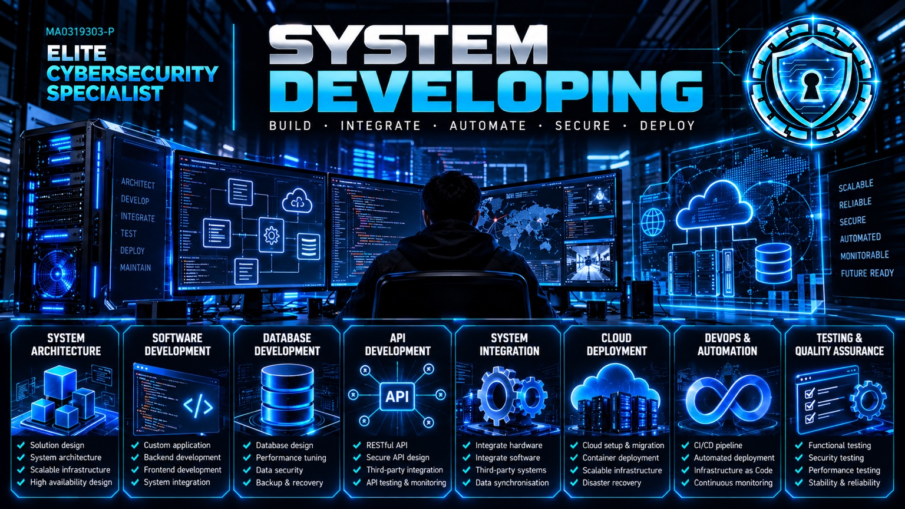
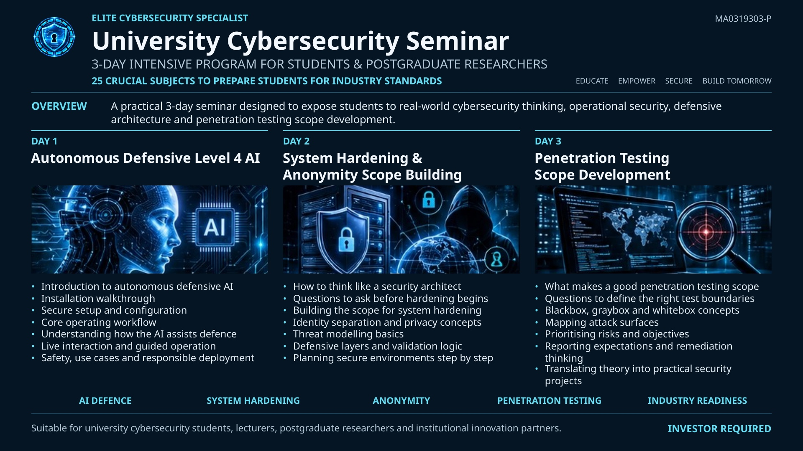
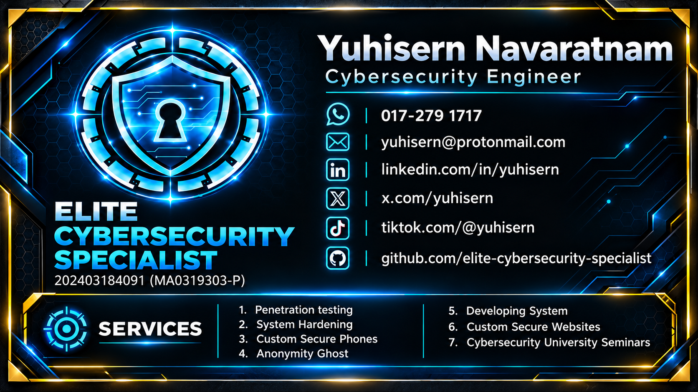

  

<h1 align="center">ELITE CYBERSECURITY SPECIALIST</h1>

<strong>Company Profile | November 2026</strong>

  <a href="pdf/ECS_Company_Profile_2026-11.pdf"><strong>View the Full Company Presentation</strong></a>
  &nbsp;·&nbsp;
  <a href="https://github.com/elite-cybersecurity-specialist">GitHub Projects</a>
  &nbsp;·&nbsp;
  <a href="https://elite-cybersecurity-specialist.blogspot.com/">Official ECS Blog</a>

> **HARDEN. TEST. VERIFY. IMPROVE.**

## Vision, Mission and About ECS

We help private-sector organisations withstand cyberattacks and recover quickly from disruption.

We use authorised RED TEAM operations and penetration testing to evaluate defences, identify weaknesses and verify that fixes work.

**Harden → Test → Validate → Remediate → Retest → Maintain**

Established in Malaysia in 2024, Elite Cybersecurity Specialist (ECS) serves private-sector organisations, businesses and enterprises. ECS specialises in offensive security, RED TEAM operations, penetration testing and cybersecurity system development. We work with a discreet network of highly skilled cybersecurity specialists and ethical hackers whose identities remain confidential. We work across endpoints, networks, servers, websites, payment integrations and the systems that support them.

  
  

## Defensive Priorities

| Priority | ECS control | Example verification |
| --- | --- | --- |
| Public websites | Separate public hosting from internal systems. | Check whether the public tier can reach a restricted system. |
| Third-party access | Limit vendor accounts to approved systems and data. | Revoke a test vendor account and verify that access is blocked. |
| Sensitive data | Restrict access and alert on attempts to cross security boundaries. | Run an authorised access check and confirm that it triggers an alert. |
| Service recovery | Maintain protected backups for priority services. | Restore a priority service and record the recovery time. |

## Our Seven Services

1. [Defensive System Hardening](#1-defensive-system-hardening)
2. [RED TEAM Operations & Advanced Penetration Testing](#2-red-team-operations--advanced-penetration-testing)
3. [Custom Secure Android Phones](#3-custom-secure-android-phones)
4. [Custom Secure Websites](#4-custom-secure-websites)
5. [Anonymity & Privacy Architecture](#5-anonymity--privacy-architecture)
6. [Cybersecurity System Development](#6-cybersecurity-system-development)
7. [University Cybersecurity Seminars](#7-university-cybersecurity-seminars)

### 1. Defensive System Hardening

Our core strength is secure configuration for infrastructure, applications and connected devices. The scope can include servers, operating systems, cloud and virtualisation platforms, websites, applications, databases, APIs, networks, Wi-Fi, CCTV, endpoints, mobile phones and IoT devices.

We identify critical functions, record the baseline, apply agreed controls, then validate exposure and service operation. Maintenance covers updates, drift, monitoring, backups and recovery. [Explore the ECS Hardening Challenge](https://github.com/elite-cybersecurity-specialist/hardening-challenge).

### 2. RED TEAM Operations & Advanced Penetration Testing

**RED TEAM operations** simulate relevant adversaries, map selected techniques to MITRE ATT&CK and assess attack paths, security controls, detection and response.

**Advanced penetration testing** validates exploitable weaknesses, including privilege escalation where authorised. ECS and the system owner agree on scope before testing. Assessments can cover web and mobile applications, APIs, authentication, access control, servers, networks, Wi-Fi, CCTV, IoT, social engineering, phishing simulations and physical access controls.

Black-box, grey-box and white-box methods reflect the access and information available. ECS validates findings, recommends remediation and retests fixes. [Explore ECS penetration testing](https://github.com/elite-cybersecurity-specialist/penetration-testing).

### 3. Custom Secure Android Phones

ECS configures GrapheneOS on supported Pixel hardware for sensitive communications and administration. The setup includes relocking the bootloader after supported installation and tailoring credentials, USB behaviour, restart settings, app separation, permissions and backups to the use case. Approved encrypted apps and protected routes, such as an always-on VPN or Tor where appropriate, depend on the agreed workflows and app compatibility.

### 4. Custom Secure Websites

ECS plans application security and deployment together. We define roles, authentication, sessions and data handling, harden the origin, restrict administration and add edge protection where appropriate. Hosted payments can reduce the payment data the application handles. We also scope dependency review, logging, backups, recovery and security testing.

Projects can include public and corporate websites, e-commerce, booking, banking and healthcare portals, memberships, dashboards, media, education, private-access sites and custom web applications. [Explore ECS secure website development](https://github.com/elite-cybersecurity-specialist/custom-secure-websites).

### 5. Anonymity & Privacy Architecture

ECS reduces identity and infrastructure exposure through hardened operator devices, separate identities, approved administrative routes and encrypted communications. The ECS Ghost Connection concept helps scope controlled routing, encrypted DNS and leak checks.

| Deployment | User access | Administrator access |
| --- | --- | --- |
| Secure Public Internet | Standard browsers reach a protected edge. The origin stays restricted. | A hardened operator device uses a separate protected route. |
| Tor Private Internet | Tor Browser reaches an onion service exposing only the agreed functionality. | Approved administrators use a separate Tor route and restricted infrastructure access. |

[Public internet architecture illustration](company-profile-images/7-anonimity.png) · [Tor private internet architecture illustration](company-profile-images/8-tor.png)

### 6. Cybersecurity System Development

ECS builds security software, integrations and automation. Capabilities include system architecture, software, databases, APIs, integrations, cloud deployment, DevOps, automation, testing and quality assurance. [Explore ECS system development](https://github.com/elite-cybersecurity-specialist/system-development).

| Engineering example | Focus |
| --- | --- |
| [Battle-Hardened AI](https://github.com/elite-cybersecurity-specialist/battle-hardened-ai) | Combines security signals, evaluates activity and applies defensive decisions across supported infrastructure. |
| [Battle Offensive AI](https://github.com/elite-cybersecurity-specialist/battle-offensive-ai) | Research into automated discovery, test selection and evidence validation in authorised environments. |
| Precision Email System | In-house software for prospect research and drafting tailored emails for human review and manual sending. |

#### Independent Research & Development

ECS independently funds research alongside client engagements. **Perfect Charity System** explores donation traceability through recipient profiles, transaction records and direct payments. **Discover New Species** explores how drone observations can flag unusual findings for expert review. Battle-Hardened AI and Battle Offensive AI are ECS cybersecurity research examples.

### 7. University Cybersecurity Seminars

The proposed three-day programme covers 25 practical subjects.

| Day | Topic | Practical focus |
| --- | --- | --- |
| 1 | Autonomous defensive AI | Set up and operate the system in a controlled environment. |
| 2 | Hardening and privacy scope | Identify what to protect, what must stay available and where exposure can be reduced. |
| 3 | Penetration testing scope | Define authorised boundaries and connect findings to remediation. |

## Security Standards and Frameworks

| Area | Guidance |
| --- | --- |
| Configuration hardening | CIS Controls and Benchmarks. Selected DISA STIG and SRG guidance. |
| Governance and access | NIST CSF 2.0, NIST SP 800-53, NIST SP 800-207 and ISO/IEC 27001 and 27002 principles. |
| Application security | OWASP Top 10, ASVS and API Security. NIST SSDF (SP 800-218) and CISA Secure by Design. |
| Threat-informed assessment | MITRE ATT&CK for realistic techniques and attack paths. |

## Monitoring, Backups and Response

ECS can scope security and service monitoring, integrity reviews, controlled updates, encrypted backups, recovery testing and incident response. Recovery tests check whether backups and rebuild procedures can restore the service.

## Our Prospective Clients

Private-sector clients include private banks, family offices, payment providers, gaming businesses, privacy-sensitive professionals and enterprise cybersecurity teams. ECS also offers cybersecurity seminars for universities.

## What Clients Receive

Depending on scope, clients receive a configuration baseline and documented changes, validated findings and retest results, architecture and operating guidance, and operational support for monitoring, backups, recovery or incidents. ECS documents remaining risks and shares sensitive implementation details through agreed channels.

## Connect with Elite Cybersecurity Specialist

**Yuhisern Navaratnam** — Cybersecurity Engineer  
**Elite Cybersecurity Specialist** | Malaysia  
**SSM:** 202403184091 (MA0319303-P)

- [Email](mailto:Yuhisern@protonmail.com)
- [WhatsApp](https://wa.me/60172791717)
- [GitHub](https://github.com/elite-cybersecurity-specialist)
- [LinkedIn](https://www.linkedin.com/in/yuhisern/)
- [ECS LinkedIn](https://www.linkedin.com/company/elite-cybersecurity-specialist/)
- [TikTok](https://www.tiktok.com/@yuhisern)
- [X](https://x.com/yuhisern)

**HARDEN. TEST. VERIFY. IMPROVE.**
