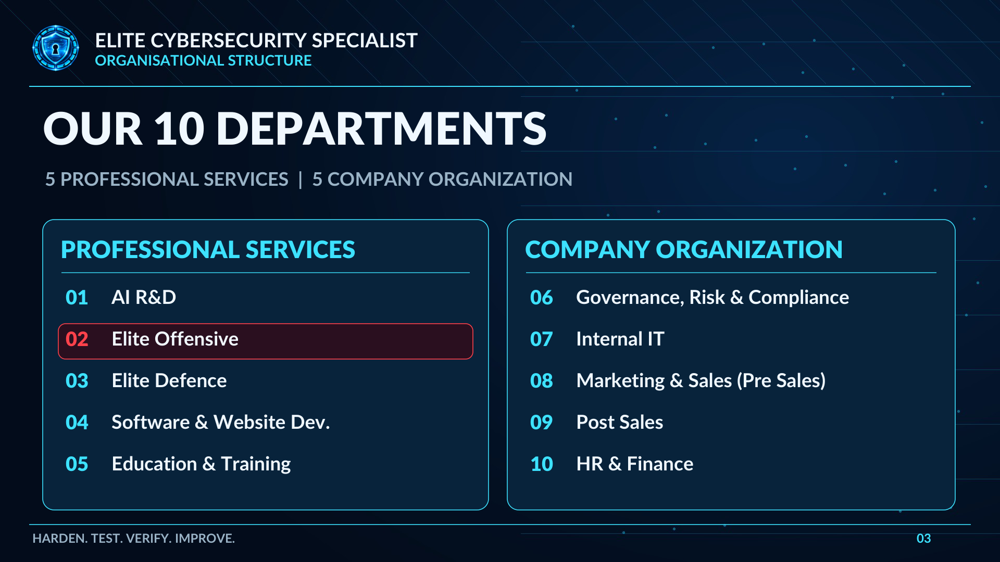
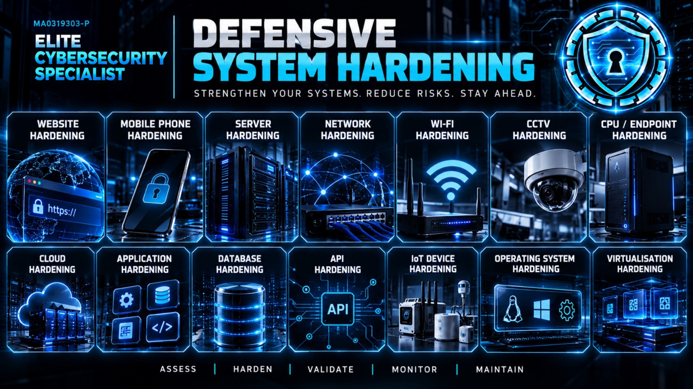
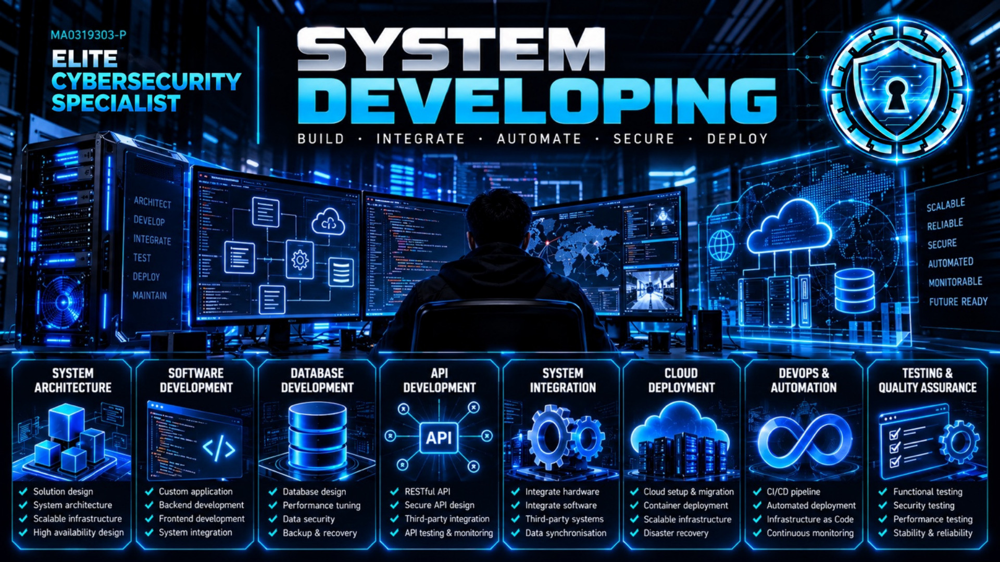
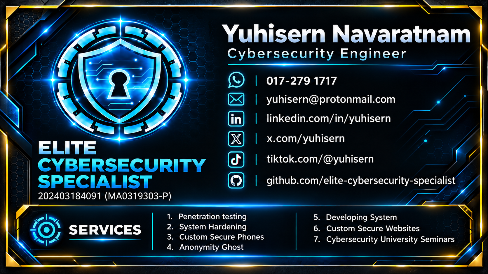

<h1 align="center">ELITE CYBERSECURITY SPECIALIST</h1>

<strong>Company Profile | November 2026</strong>

  <a href="pdf/ECS_Company_Profile_2026-11.pdf"><strong>Download Company Profile (PDF)</strong></a>
  &nbsp;·&nbsp;
  <a href="https://github.com/elite-cybersecurity-specialist">GitHub Projects</a>
  &nbsp;·&nbsp;
  <a href="https://elite-cybersecurity-specialist.blogspot.com/">Official ECS Blog</a>

> **HARDEN. TEST. VERIFY. IMPROVE.**

## About ECS

Established in Malaysia in 2024, Elite Cybersecurity Specialist (ECS) serves private-sector organisations, businesses and enterprises. Our professional services cover defensive security engineering, authorised offensive assessments, secure development, cybersecurity education and applied AI research.

We work with a discreet network of highly skilled cybersecurity specialists and ethical hackers whose identities remain confidential. Our engagements start with the client's systems, critical services and operating constraints, and advance through agreed changes and verification to a documented handover.

[Professional Services](#professional-services) · [Company Organization](#company-organization) · [How We Deliver](#how-we-deliver) · [Sales & Pricing](#sales--pricing) · [Contact](#connect-with-elite-cybersecurity-specialist)

## Our 10 Departments

| Professional Services | Company Organization |
| --- | --- |
| [01 · AI R&D](#01-ai-rd-department) | [06 · Governance Risk and Compliance][grc] |
| [02 · Elite Offensive](#02-elite-offensive-department) | [07 · Internal IT][internal-it] |
| [03 · Elite Defence](#03-elite-defence-department) | [08 · Marketing & Sales (Pre Sales)][pre-sales] |
| [04 · Software & Website Development](#04-software--website-development-department) | [09 · Post Sales][post-sales] |
| [05 · Education & Training](#05-education--training-department) | [10 · HR & Finance][hr-finance] |

### Organisational Hierarchy

[![ECS 2–6–2 organisational hierarchy. Administration and Governance has two departments, Technical and Professional Services has six, and Business Operations has two.][org-chart]][org-chart]

**Reporting chain** · Workers → Team Leaders → Managers → Directors → CEO → Chairman

| Reporting branch | Leadership | Departments |
| --- | --- | --- |
| Governance & Administration | Director of Governance, HR & Finance → Manager — Governance & Administration | 06 and 10 |
| Technical & Professional Services | Chief Technology Officer (CTO) → Manager — Internal IT & Technical Services | 01–05 and 07 |
| Business Operations | Director of Operations → Manager — Business Operations | 08 and 09 |

## Professional Services

### 01. AI R&D Department

ECS researches defensive automation, threat intelligence, security analytics and agent-assisted testing. Research includes developing prototypes, evaluating controls and assessing operational suitability against the requirements of each engagement.

| Research project | Focus |
| --- | --- |
| [Battle-Hardened AI](https://github.com/elite-cybersecurity-specialist/battle-hardened-ai) | Autonomous defensive analysis, validation, security decisions and adaptable controls. |
| [Battle Offensive AI](https://github.com/elite-cybersecurity-specialist/battle-offensive-ai) | Agent-assisted research into authorised assessment workflows, test selection and evidence validation. |

[Department overview][ai-overview] · [AI research portfolio][ai-portfolio]

### 02. Elite Offensive Department

**RED TEAM Operations & Advanced Penetration Testing.** ECS agrees written authorisation, test boundaries and objectives with the asset owner. RED TEAM exercises simulate relevant adversaries and validate attack paths, security controls, detection and response. Penetration testing discovers and validates exploitable weaknesses, records their impact, and gives the client remediation and retest priorities.

| Assessment | Scope and approach |
| --- | --- |
| Black Box | External assessment with little or limited internal information. |
| Grey Box | Targeted testing with selected access, credentials or system information. |
| White Box | Deeper assessment with approved access to architecture, source code or privileged context. |
| RED TEAM | Objective-led adversary simulation using threat-informed techniques, including relevant MITRE ATT&CK techniques. |
| Purple Team | Offensive and defensive specialists run scoped exercises together to improve detection and response. |

Agreed scopes can include web and mobile applications, APIs, authentication and access controls, networks, wireless, cloud, identity infrastructure, CCTV and IoT. Any social engineering, phishing simulation or physical access testing is scoped with the owner.

[Department overview][offensive-overview] · [Testing methods][testing-methods] · [ECS Penetration Testing](https://github.com/elite-cybersecurity-specialist/penetration-testing)

### 03. Elite Defence Department

**Defensive System Hardening.** ECS assesses existing configuration, maps applicable controls, applies approved changes and verifies both enforcement and service operation. Scope can include Linux and Windows servers, operating systems, cloud, virtualisation, websites, APIs, databases, endpoints, networks, Wi-Fi, CCTV and IoT. Ongoing work can cover integrity monitoring, controlled updates, encrypted backups and recovery checks.

**Custom Secure Android Phones.** ECS configures GrapheneOS on supported Google Pixel devices for sensitive communications and administration. The agreed setup can cover verified installation, bootloader relocking, app separation, credentials, USB settings, approved encrypted apps and recovery arrangements. [Secure Android illustration][secure-android]

**Anonymity & Privacy Architecture.** ECS designs hardened operator devices, separate administration identities, restricted infrastructure access and protected communication routes. The design can use a protected public edge and separate origin, or a Tor-only service for an agreed private workflow. We validate access boundaries and routing against the threat model. [Public internet and payment architecture][public-architecture] · [Tor-only architecture][tor-architecture]

[Department overview][defence-overview] · [ECS Hardening Challenge](https://github.com/elite-cybersecurity-specialist/hardening-challenge)

### 04. Software & Website Development Department

**Cybersecurity System Development.** ECS designs and develops applications, custom software, APIs, databases, integrations and security automation. Delivery covers requirements and data flows, architecture, secure coding, dependency review, functional and security testing, deployment and handover.

**Custom Secure Websites.** ECS plans user roles, authentication, sessions and data handling together with deployment. Projects can include corporate sites, online stores, portals, dashboards and custom web applications. Scope can include origin hardening, edge protection, hosted payment integrations, logging, backups and recovery.

[Department overview][development-overview] · [Custom secure website types][website-types] · [ECS System Development](https://github.com/elite-cybersecurity-specialist/system-development) · [ECS Custom Secure Websites](https://github.com/elite-cybersecurity-specialist/custom-secure-websites)

### 05. Education & Training Department

ECS offers university seminars, practical workshops and corporate training. The proposed three-day university programme covers 25 planned subjects, with scope and materials agreed with each institution.

| Day | Focus |
| --- | --- |
| 1 | Autonomous Defensive AI, guided operation and safeguards in a controlled environment. |
| 2 | System hardening and privacy, including asset discovery, threat models and applicable controls. |
| 3 | Authorised penetration-testing scope, Black/Grey/White Box concepts, reporting and remediation. |

[Department overview][education-overview] · [Three-day seminar outline][seminar-outline]

## Company Organization

| Department | Responsibility |
| --- | --- |
| [06 · Governance Risk and Compliance Department][grc] | Owns policy oversight, risk registers, control applicability, third-party risk and audit evidence. |
| [07 · Internal IT Department][internal-it] | Runs ECS employee systems, access, the corporate network, asset lifecycle, backups and the internal service desk. |
| [08 · Marketing & Sales Department (Pre Sales)][pre-sales] | Qualifies enquiries, runs discovery and coordinates technical scoping, proposals and handover to delivery. |
| [09 · Post Sales Department][post-sales] | Coordinates customer support, specialist escalation, agreed maintenance, service follow-up and renewals. |
| [10 · HR & Finance Department][hr-finance] | Manages staffing, administration, payroll, budgeting, invoicing and procurement. |

### Security Standards and Company Credentials

| Area | Engineering references |
| --- | --- |
| Configuration hardening | Applicable CIS Controls and Benchmarks, DISA STIG/SRG guidance and vendor safeguards. |
| Governance and access | NIST CSF 2.0, NIST SP 800-53, NIST SP 800-207, and ISO/IEC 27001 and 27002 principles. |
| Application security | OWASP Top 10, ASVS and API Security, NIST SSDF (SP 800-218), and CISA Secure by Design. |
| Threat-informed assessment | MITRE ATT&CK for relevant techniques and attack paths. |

The corporate roadmap includes the Sdn. Bhd. transition and work toward applicable NACSA licensing, CyberSecurity Malaysia PTSP certification, CREST company accreditation and ISO/IEC 27001 certification. [NACSA licensing](https://www.nacsa.gov.my/application-licensing.php) · [CyberSecurity Malaysia PTSP scheme](https://iscb.cybersecurity.my/index.php/certification/management-system-certification/penetration-test/how-to-apply-2)

## How We Deliver

**Discover → Scope → Baseline → Execute → Verify → Handover**

The engagement begins with asset ownership, critical services, dependencies and agreed boundaries. ECS then records the baseline, implements or tests within change controls, and verifies the agreed security and service outcomes before handover.

### What Clients Receive

- Agreed scope, asset inventory, baseline and applicable security requirements.
- Documented changes, verification results, validated findings and practical remediation priorities.
- Before-and-after evidence, accepted exceptions, retest results and remaining risk where relevant.
- Operational guidance, ownership and support arrangements for maintenance, monitoring, backups, recovery or incident response as agreed.

Private-sector clients include private banks, family offices, payment providers, gaming businesses, privacy-sensitive professionals and enterprise cybersecurity teams. ECS also offers cybersecurity seminars for universities.

## Sales & Pricing

ECS publishes indicative selling ranges in Malaysian Ringgit (RM). Each quotation defines assets, scope, deliverables, exclusions and acceptance criteria. Hardware, third-party services, travel and applicable taxes are excluded unless expressly included.

| Service | Indicative ECS rate |
| --- | ---: |
| Linux or Windows Server hardening, standard scope | From RM5,000 per server |
| Extended production server hardening | RM15,000–40,000+ |
| Supported Google Pixel / GrapheneOS setup | RM5,000 per device for engineering |
| Standard website or application hardening | From RM10,000 per site |
| Black Box web application testing | RM8,000–20,000 |
| Grey Box web application testing | RM10,000–25,000 |
| White Box web application testing | RM12,000–30,000 |
| RED TEAM adversary simulation | RM50,000–150,000+ |
| Purple Team exercise | RM60,000–150,000+ |
| Custom secure website development | RM15,000–50,000+ |
| Software or system development | RM30,000–150,000+ |
| Cybersecurity seminar or workshop | RM3,000–12,000 |

[Full pricing tables, engineering scope and commercial terms (PDF)](pdf/ECS_Company_Profile_2026-11.pdf)

## Connect with Elite Cybersecurity Specialist

  

**Yuhisern Navaratnam** — Cybersecurity Engineer 
**Elite Cybersecurity Specialist** | Malaysia 
**SSM:** 202403184091 (MA0319303-P)

- [Email](mailto:Yuhisern@protonmail.com)
- [WhatsApp](https://wa.me/60172791717)
- [GitHub](https://github.com/elite-cybersecurity-specialist)
- [LinkedIn](https://www.linkedin.com/in/yuhisern/)
- [ECS LinkedIn](https://www.linkedin.com/company/elite-cybersecurity-specialist/)
- [TikTok](https://www.tiktok.com/@yuhisern)
- [X](https://x.com/yuhisern)

**HARDEN. TEST. VERIFY. IMPROVE.**

[org-chart]: assets/ecs-2026/source-images/latest-pdf-key-pages/04-org-chart-approved-2-6-2.png
[defence-overview]: assets/ecs-2026/slides/01-professional-services/01-elite-defence/11-elite-defence-department-overview.jpg
[secure-android]: assets/ecs-2026/slides/01-professional-services/01-elite-defence/14-custom-secure-android-phones.jpg
[public-architecture]: assets/ecs-2026/slides/01-professional-services/01-elite-defence/16-cloudflare-and-payment-architecture.jpg
[tor-architecture]: assets/ecs-2026/slides/01-professional-services/01-elite-defence/17-tor-only-private-architecture.jpg
[offensive-overview]: assets/ecs-2026/slides/01-professional-services/02-elite-offensive/18-elite-offensive-department-overview.jpg
[testing-methods]: assets/ecs-2026/slides/01-professional-services/02-elite-offensive/20-testing-methods-black-grey-white-purple.jpg
[development-overview]: assets/ecs-2026/slides/01-professional-services/03-software-website-development/22-software-website-development-overview.jpg
[website-types]: assets/ecs-2026/slides/01-professional-services/03-software-website-development/24-custom-secure-websites.jpg
[education-overview]: assets/ecs-2026/slides/01-professional-services/04-education-training/26-education-training-department-overview.jpg
[seminar-outline]: assets/ecs-2026/slides/01-professional-services/04-education-training/28-three-day-seminar-outline.jpg
[ai-overview]: assets/ecs-2026/slides/01-professional-services/05-ai-research-development/29-ai-research-development-overview.jpg
[ai-portfolio]: assets/ecs-2026/slides/01-professional-services/05-ai-research-development/31-ai-research-portfolio.jpg
[grc]: assets/ecs-2026/slides/02-company-organization/06-governance-risk-compliance/33-governance-risk-compliance-overview.jpg
[internal-it]: assets/ecs-2026/slides/02-company-organization/07-internal-it/38-internal-it-department-overview.jpg
[pre-sales]: assets/ecs-2026/slides/02-company-organization/08-marketing-sales-pre-sales/41-marketing-sales-pre-sales-overview.jpg
[post-sales]: assets/ecs-2026/slides/02-company-organization/09-post-sales/44-post-sales-department-overview.jpg
[hr-finance]: assets/ecs-2026/slides/02-company-organization/10-hr-finance/47-hr-finance-department-overview.jpg
