<p align="center">
  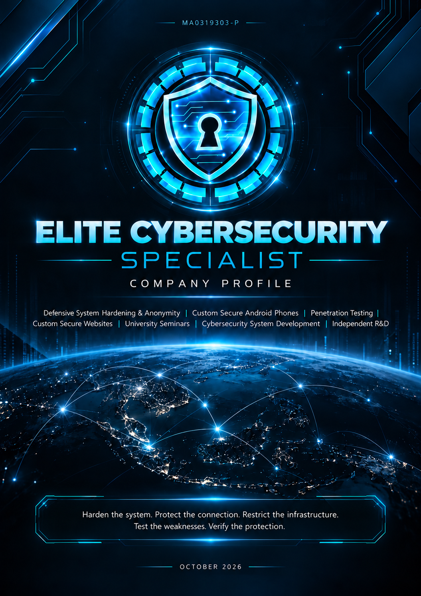
</p>

<h1 align="center">ELITE CYBERSECURITY SPECIALIST</h1>

<p align="center"><strong>Company Profile | October 2026</strong></p>

<p align="center">
  
</p>

<p align="center">
  <a href="https://github.com/elite-cybersecurity-specialist/company-profile/raw/refs/heads/main/pdf/ECS_Company_Profile.pdf"><strong>Download Company Profile</strong></a>
  &nbsp;·&nbsp;
  <a href="https://github.com/elite-cybersecurity-specialist"><strong>View Other Cybersecurity Subjects</strong></a>
  &nbsp;·&nbsp;
  <a href="mailto:Yuhisern@protonmail.com"><strong>Contact ECS</strong></a>
</p>

> [!NOTE]
> **HARDEN. TEST. VERIFY. IMPROVE.**
>
> Harden the system. Protect the connection. Restrict the infrastructure. Test the weaknesses. Verify the protection.

---

## Contents

- [Founder Introduction](#founder-introduction)
- [Company Information](#company-information)
- [About Us](#about-us)
- [Who Our Services Are Designed For](#who-our-services-are-designed-for)
- [Our Core Services](#our-core-services)
- [Defensive System Hardening](#defensive-system-hardening)
- [Custom Secure Android Phones](#custom-secure-android-phones)
- [Custom Secure Websites](#custom-secure-websites)
  - [Method 1 — Secure Public Internet](#method-1--secure-public-internet)
  - [Method 2 — Tor Private Internet](#method-2--tor-private-internet)
- [Cybersecurity System Development](#cybersecurity-system-development)
- [Penetration Testing & Security Assessment](#penetration-testing--security-assessment)
- [University Seminars](#university-seminars)
- [Independent Self-Funded Research & Development](#independent-self-funded-research--development)
- [Our Working Method](#our-working-method)
- [Security Guidelines & Industry Frameworks](#security-guidelines--industry-frameworks)
- [Monitoring, Backup & Incident Response](#monitoring-backup--incident-response)
- [What Customers May Receive](#what-customers-may-receive)
- [What We Do Not Publicly Expose](#what-we-do-not-publicly-expose)
- [Security Reality](#security-reality)
- [Connect with Elite Cybersecurity Specialist](#connect-with-elite-cybersecurity-specialist)

---

## Founder Introduction

<p align="center">
  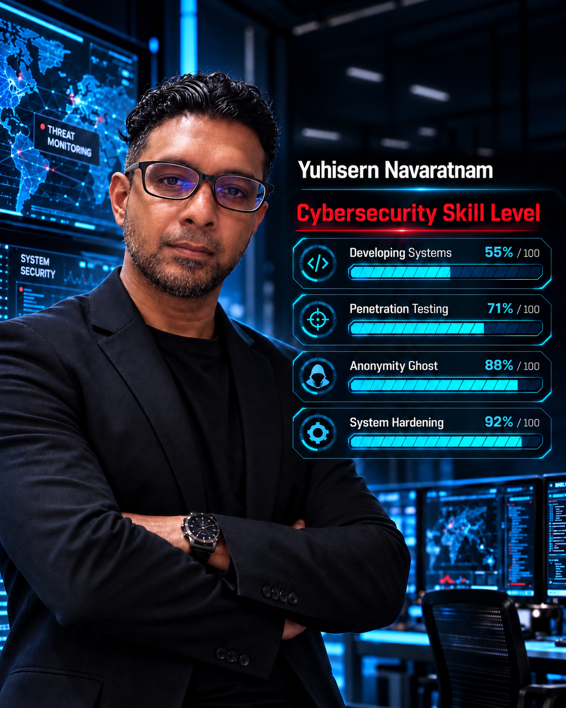
</p>

**Yuhisern Navaratnam** — Cybersecurity Engineer · Founder of ELITE CYBERSECURITY SPECIALIST.

---

## Company Information

| Detail | Information |
|---|---|
| **Company** | ELITE CYBERSECURITY SPECIALIST |
| **Business Registration** | 202403184091 (MA0319303-P) |
| **Founder / Contact** | Yuhisern Navaratnam |
| **Email** | [Yuhisern@protonmail.com](mailto:Yuhisern@protonmail.com) |
| **Phone / WhatsApp** | [+60 17-279 1717](https://wa.me/60172791717) |
| **Country** | Malaysia |

---

## About Us

**ELITE CYBERSECURITY SPECIALIST** is a Malaysia-based cybersecurity company founded in 2024 by **Yuhisern Navaratnam**, bringing more than 10 years of cybersecurity experience into a focused security practice built around one principle: **security must be designed, tested, verified and continuously improved.**

Our work is not limited to installing individual security products. We look at the entire environment as one connected security architecture — from the device in the user's hands, to the network connection, servers, websites, administrative access, payment infrastructure, communication systems and the cybersecurity technologies operating behind them.

Our core capabilities include **Defensive System Hardening, Anonymity & Privacy Architecture, Custom Secure Android Phones, Penetration Testing & Security Assessment, Custom Secure Websites, University Cybersecurity Seminars and Cybersecurity System Development.** These capabilities allow us to approach cybersecurity from both sides: strengthening systems defensively while also examining them from an attacker's perspective through authorized security testing.

**Our security lifecycle:**

```text
HARDEN → TEST → VALIDATE → REMEDIATE → RE-TEST → MAINTAIN
```

Security is not treated as a one-time configuration. Every important defensive change should be tested, its effectiveness verified, weaknesses corrected and the environment reviewed again as technologies and threats evolve.

Where appropriate, our work is informed by established cybersecurity frameworks and security principles including CIS Controls and Benchmarks, DISA STIG / SRG principles, NIST Cybersecurity Framework, NIST SP 800-53, NIST Zero Trust, OWASP, OWASP ASVS, OWASP API Security, MITRE ATT&CK, NIST SSDF, CISA Secure by Design and ISO/IEC 27001 & 27002 principles. These frameworks are applied according to the actual system, risk profile and operational requirements rather than treated as a generic checklist.

We also develop specialized cybersecurity systems rather than operating as a general software-development company. This includes security automation, defensive technologies, cybersecurity AI, monitoring systems, attack-surface analysis, penetration-testing technology, security analytics and access-control systems.

Beyond commercial services, ELITE CYBERSECURITY SPECIALIST independently funds experimental research and development projects intended to explore new approaches in cybersecurity, autonomous systems and other technology fields.

> [!NOTE]
> **Our objective:** Reduce unnecessary exposure, strengthen critical systems, improve resilience, protect sensitive operations and make every environment significantly harder to compromise.

> [!NOTE]
> We do not secure only one component. We secure the complete environment.

---

## Who Our Services Are Designed For

Our services are intended for individuals and organizations that handle sensitive information, valuable infrastructure, private communications or high-risk online operations.

| Customer Profile | Why It Fits |
|---|---|
| Private Banks & Private Financial Organizations | High-sensitivity administrative systems, internal access paths, private infrastructure and customer-facing services. |
| Private Casinos & Gaming Businesses | Administrative systems, private servers, public services and payment-support environments where compromise can create major operational impact. |
| Investigative Journalists & Source-Protection Teams | Identity separation, private communications, protected research environments and reduced infrastructure exposure. |
| Legal Professionals & Confidential Advisory Firms | Privileged communications, sensitive documents, client work and private administrative infrastructure. |
| Executives, VIPs & High-Profile Individuals | Hardened devices, protected administration and reduced unnecessary exposure. |
| Ministers, Public Officials & Sensitive Professional Teams | Compartmentalized communications and stronger defensive security for authorized systems. |
| Family Offices & Private Wealth Organizations | Protection for sensitive financial administration, private communications and infrastructure. |
| High-Sensitivity Businesses & Online Businesses | Businesses that require stronger protection than a normal consumer device, VPS and website configuration. |
| Cybersecurity Companies & Security Teams | Defensive environments, authorized testing, internal security tooling and research. |
| Universities, Researchers & Postgraduate Programs | Authorized cybersecurity research, privacy engineering and security experimentation. |

---

## Our Core Services

<p align="center">
  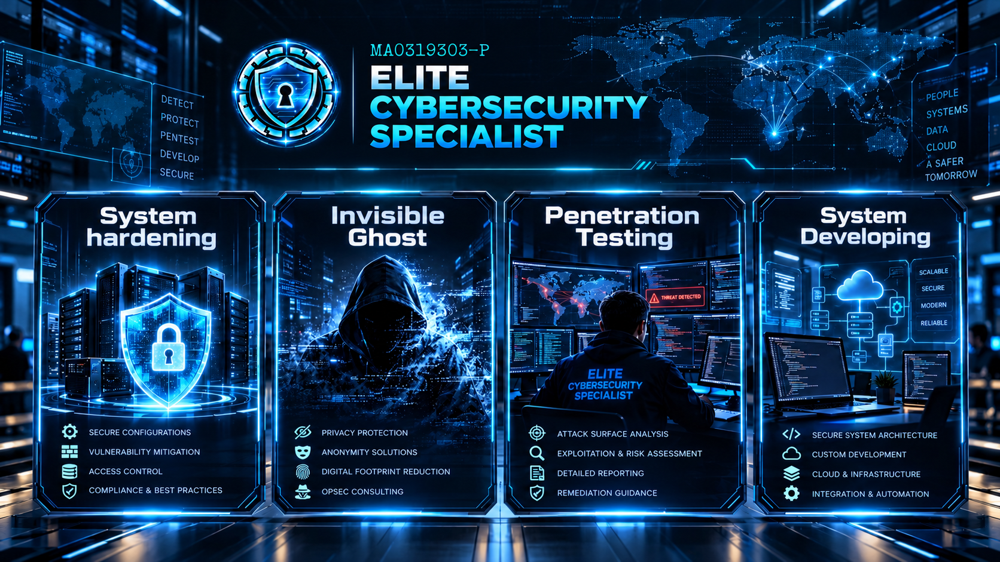
</p>

| Service Area | What We Do |
|---|---|
| **System Hardening & Anonymity** | Strengthen websites, mobile devices, servers, networks, Wi-Fi, CCTV, endpoints and privacy-sensitive administration as one controlled security environment. |
| **Custom Secure Android Phones** | Build hardened mobile devices for sensitive communications using supported hardware, hardened operating systems, controlled network routing and privacy-focused application separation. |
| **Penetration Testing & Security Assessment** | Test systems from an attacker's point of view using authorized black-box, gray-box and white-box methods, then validate, remediate and re-test weaknesses. |
| **Custom Secure Websites** | Design and develop security-first websites and web applications for business, private, financial, educational and privacy-sensitive use cases. |
| **University Seminars** | Deliver a proposed 3-day cybersecurity seminar covering 25 crucial subjects to prepare students for practical industry standards and real security scope-building. |
| **Cybersecurity System Development** | Develop specialized cybersecurity systems, defensive tools, autonomous security technologies, analytics and security automation. |

---

## Defensive System Hardening

<p align="center">
  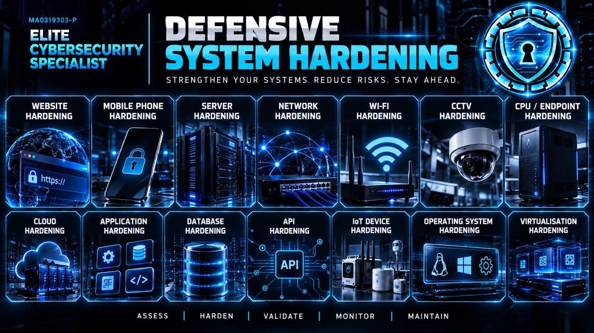
</p>

System hardening is the process of reducing the number of ways a system can be attacked, misused or accidentally exposed. We start by understanding what the customer actually needs the system to do, then secure the operating system, applications, accounts, network paths and management interfaces around that purpose.

The aim is not to lock down a system until it becomes unusable. The aim is to remove unnecessary exposure, strengthen the controls that must remain, and verify that the environment still works correctly after the security changes are applied.

> [!NOTE]
> **Our hardening principle:** Keep what is required. Restrict what is sensitive. Remove what is unnecessary. Verify everything that changes.

### What We Can Harden

The exact hardening scope depends on the customer environment. The following are the main areas we can assess and strengthen before moving into the deeper proof-of-concept architecture.

#### Website Hardening

We strengthen the website and the infrastructure supporting it so that unnecessary functionality, exposed administration, weak configuration and avoidable information leakage are reduced. This can include web-server configuration, HTTPS/TLS, security headers, authentication, session security, dependencies, administrative interfaces, edge protection, WAF policies, backups and origin exposure where relevant.

**Customer outcome:** A website that reveals less, exposes less and places stronger defensive controls between the public internet and the underlying application.

#### Mobile Phone Hardening

Mobile devices can become a direct route into sensitive accounts and communications. We review device configuration, encryption, screen-lock and biometric controls, operating-system updates, application permissions, account security, secure DNS/VPN use, backup behavior, lost-device protection and unnecessary services.

**Customer outcome:** A mobile device configured for sensitive use with fewer unnecessary permissions, stronger account protection and better control of data exposure.

#### Servers & Networks

Servers and networks are hardened around the services they genuinely need to provide. We review exposed ports and services, remote administration, authentication, firewall policy, segmentation, update state, logging, privileged access, secrets, backups and recovery. Unnecessary public exposure is removed or restricted wherever possible.

**Customer outcome:** Infrastructure with a smaller attack surface, clearer administrative boundaries and a defined recovery path if a server or account is compromised.

#### Wi-Fi Hardening

Wireless security is reviewed as part of the wider network, not as an isolated password setting. We assess encryption and authentication, router or access-point administration, firmware, guest separation, unnecessary discovery features, WPS, connected-device exposure and segmentation between trusted and less-trusted devices.

**Customer outcome:** A wireless environment that is harder to abuse, easier to control and less likely to expose sensitive systems to every device on the same network.

#### CCTV Hardening

CCTV systems can contain cameras, recorders, VMS platforms, APIs, cloud features and remote-access services. We review account security, default or weak credentials, exposed management interfaces, firmware, network segmentation, remote access, unnecessary services, logging, user roles and internet-facing exposure.

**Customer outcome:** Cameras and video systems that remain useful to the customer without becoming an unnecessary entry point into the wider network.

#### CPU / Endpoint Hardening

Endpoints used for administration or sensitive work are reviewed for disk encryption, boot protection, operating-system security, privilege separation, local services, software exposure, device controls, authentication, logging, patching and recovery.

**Customer outcome:** A controlled endpoint with stronger protection against unauthorized access, malware persistence and accidental exposure.

#### Additional Hardening Scopes

Where required, hardening can extend to cloud environments, applications, databases, APIs, IoT devices, operating systems and virtualisation platforms. The exact controls are selected according to technology, business requirements and risk profile rather than applied as a generic checklist.

### How We Harden a Customer Environment

| Stage | What Happens |
|---|---|
| **1. Understand** | Identify how the system is used, which services are genuinely required and which business functions cannot be interrupted. |
| **2. Baseline** | Record the important security state before changes so we know what is already protected and what requires improvement. |
| **3. Harden** | Apply only the controls that are relevant to the platform and customer use case, using recognized security guidance where appropriate. |
| **4. Validate** | Confirm the system still works, review exposure again and verify the security changes achieved the intended result. |
| **5. Maintain** | Keep the environment updated, review new exposure, re-test important changes and maintain backup/recovery capability. |

Where stronger privacy is required, system hardening can be combined with identity separation, encrypted DNS, controlled privacy routing, protected administration and concealed infrastructure. The following POC examples show how these layers can work together.

The computer system's configuration must also align with connected services such as websites. Security controls need to operate together to avoid configuration clashes, bugs and unwanted problems.

---

## Custom Secure Android Phones

<p align="center">
  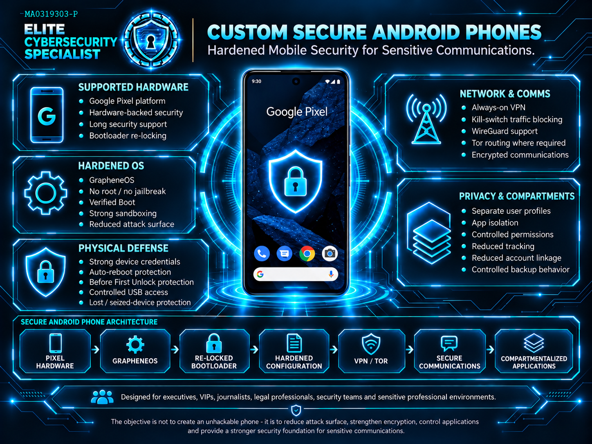
</p>

Custom Secure Android Phones are configured for customers who require substantially stronger mobile privacy, device security and communication protection than a conventional smartphone. The service is intended for executives, VIPs, high-profile families, journalists, legal professionals, security teams, public officials and future authorized government or law-enforcement deployments.

The goal is not to create a magic or unhackable phone. The goal is to reduce attack surface, strengthen encryption, control applications, reduce unnecessary tracking and give sensitive communications a much stronger security foundation.

### Hardware & Core Architecture

- Supported Google Pixel hardware is selected for strong hardware-backed security, bootloader relocking, long security-support periods and compatibility with hardened Android operating systems.
- The device is not rooted or jailbroken. Stock software is wiped and a hardened open-source operating system such as GrapheneOS is installed.
- After installation, the bootloader is re-locked so Verified Boot can protect the operating system and detect unauthorized modification.
- Security configuration is selected according to the customer's threat model instead of applying one generic profile to every user.

### Hardened Operating System & Physical Defenses

- GrapheneOS does not include Google apps or Google Play services by default. Sandboxed Google Play can be added only where application compatibility requires it.
- Hardened memory protections, exploit mitigations, stronger sandboxing and reduced attack surface are used to raise the difficulty of exploitation.
- Auto-reboot, Before First Unlock protection, strong device credentials and controlled USB behavior can reduce exposure if a device is lost, stolen or physically seized.
- User profiles and application separation can compartmentalize sensitive communications from less-trusted applications.

### Network & Communications

- Always-on VPN and traffic-blocking controls can be configured to prevent normal traffic from bypassing the protected route.
- WireGuard-based VPN services or Tor routing can be selected according to the customer's operating model and privacy requirements.
- Privacy-focused encrypted communication applications can be configured according to the threat model. SimpleX can be used where minimizing persistent identifiers is important.
- Application sourcing, permissions, DNS behavior, backup behavior and account linkage are reviewed to reduce unnecessary identity exposure.

**Secure mobile architecture:**

```text
Supported Pixel Hardware → GrapheneOS → Re-Locked Bootloader
    → Hardened Configuration → VPN / Tor
    → Secure Communications → Compartmentalized Applications
```

---

## Custom Secure Websites

<p align="center">
  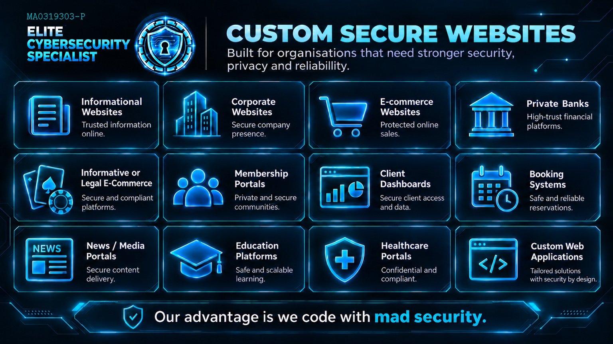
</p>

We design and develop custom websites where security is considered from the first line of code instead of being added only after launch. The objective is to combine clean development, practical business functionality and a stronger defensive foundation.

> [!NOTE]
> **Our advantage:** We code with mad security.

### Website Security Architecture — System Hardening & Anonymity

The following proof-of-concept examples show how individual hardening controls can be connected into a larger privacy and infrastructure-protection architecture. The diagrams are designed to help customers understand the full flow without publishing sensitive implementation details.

| Protection Layer | Customer Outcome |
|---|---|
| High Security Laptop | Harden the operator endpoint, protect storage, reduce unnecessary services, separate normal use from administration and strengthen device controls. |
| High Security Ghost Connection | Reduce unnecessary exposure of the operator's normal network identity using controlled privacy routes, encrypted DNS and leak controls. |
| High Security Private Server | Restrict administration, minimize services, harden the operating system, apply firewall controls, monitor activity and maintain recovery capability. |
| High Security Armoured Website | Put defensive layers in front of the public application, reduce origin exposure, harden headers and limit unnecessary functionality and data. |
| High Security Payment Gateway | Separate payment processing from the website wherever practical and protect payment administration with strong account security. |

#### Method 1 — Secure Public Internet

<p align="center">
  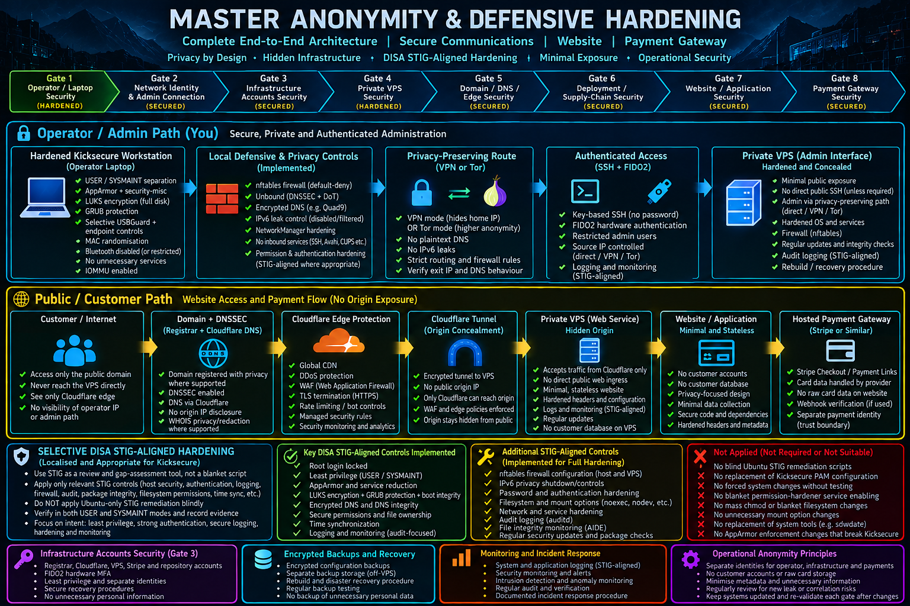
</p>

This method is intended for organizations that still require a normal public website accessible through ordinary browsers and a standard web address. The website remains public, while the private origin, administration path and payment environment are separated and protected.

| Step | Layer | Purpose |
|---|---|---|
| 1 | High Security Laptop | Hardened operator device used for secure administration. |
| 2 | High Security Ghost Connection | Privacy-preserving route for infrastructure administration. |
| 3 | High Security Private Server | Restricted and hardened private origin environment. |
| 4 | Protected Internet Edge | Public traffic meets edge security, WAF, DDoS and abuse controls before the origin. |
| 5 | High Security Armoured Website | Minimal customer-facing application with reduced unnecessary exposure. |
| 6 | High Security Payment Gateway | Hosted payment flow separated from the website and protected by strong account security. |

#### Method 2 — Tor Private Internet

<p align="center">
  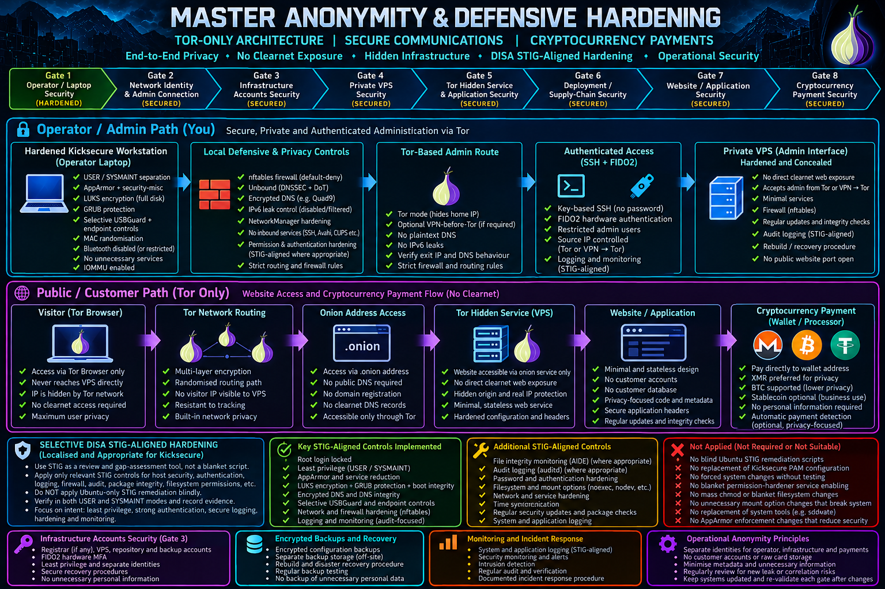
</p>

This method is intended for customers who require a much more private online environment where the service does not need conventional public-web exposure. Users access the service through Tor Browser using an onion address rather than a normal public website.

| Step | Layer | Purpose |
|---|---|---|
| 1 | High Security Laptop | Hardened operator device with strict separation from ordinary activity. |
| 2 | High Security Ghost Connection — Tor | Tor-focused private administration and reduced normal-IP exposure. |
| 3 | High Security Private Server | Restricted private infrastructure supporting the hidden service. |
| 4 | Tor Onion Service | Hidden-service access without a normal public website requirement. |
| 5 | High Security Armoured Hidden Website | Minimal hidden application with reduced exposure and hardened configuration. |
| 6 | Cryptocurrency Payment Environment | Wallet or processor workflow selected according to the customer's lawful business requirements. |

#### Secure Communications & Administrative Separation

Sensitive environments may require stronger separation between ordinary communications and protected communications. Depending on customer requirements, this can include compartmentalized accounts, encrypted communication platforms, isolated browser profiles, separate administrator identities, contact verification and restricted devices.

### Custom Website Types & Applications

| Website Type | Customer-Focused Purpose |
|---|---|
| Informational Websites | Secure public information, company profiles, services and professional online presence. |
| Corporate Websites | Business websites with secure administration, clean architecture and professional delivery. |
| E-Commerce Websites | Product catalogues, checkout integration, order workflows and hosted payment gateways with reduced unnecessary data exposure. |
| Private Banking Portals | High-trust financial portals and private financial-service environments designed around strong authentication, restricted administration and applicable regulatory requirements. |
| Deep Web Websites | Informational or lawful e-commerce environments using private-access or onion-service architectures where appropriate. |
| Membership Portals | Private member areas, restricted content, communities and controlled account access. |
| Client Dashboards | Secure customer dashboards for information, reporting, workflows and controlled data access. |
| Booking & Reservation Systems | Appointments, hospitality, events, professional services and reservation workflows. |
| News / Media Portals | Publishing, journalism and editorial platforms with secure administration and resilient content delivery. |
| Education Platforms | University, training, research and learning portals with structured user access and secure administration. |
| Healthcare Portals | Confidential portals and web applications where privacy, controlled access and secure design are especially important. |
| Custom Web Applications | Purpose-built web systems and interfaces developed around the customer's business requirements and security needs. |

### Security-First Website Development

- Secure code from the ground up, with unnecessary exposure reduced during design rather than only after deployment.
- Hardened administrative access, strong authentication, encrypted traffic and reduced attack surface.
- Payment integration designed to keep unnecessary payment data away from the website wherever practical.
- Logging, monitoring, backups and recovery considered as part of the operating environment.
- Penetration-test readiness so important weaknesses can be identified and remediated before or after launch.

**Website delivery flow:**

```text
PLAN → DESIGN → DEVELOP → HARDEN → PENETRATION TEST → DEPLOY → MAINTAIN
```

---

## Cybersecurity System Development

<p align="center">
  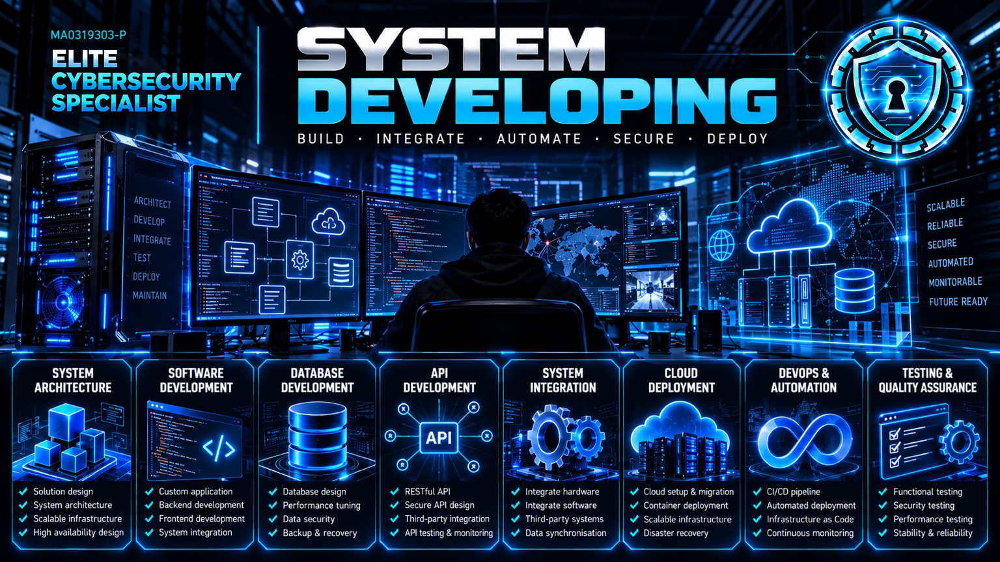
</p>

ELITE CYBERSECURITY SPECIALIST is **not a general software-development company**. Our development work is focused specifically on systems related to cybersecurity.

This can include security automation, defensive systems, autonomous security technology, cybersecurity AI, monitoring systems, attack-surface analysis, penetration-testing technology, security analytics, access-control systems and other specialized cybersecurity tools.

Where we develop a cybersecurity system, we can apply the same security lifecycle used elsewhere in the company: design the system, harden it, penetration-test it, remediate weaknesses and verify the final security state.

> [!NOTE]
> **Development principle:** Security should be designed into the system from the beginning, not added only after the system is already finished.

```text
DEVELOP → HARDEN → TEST → VERIFY → IMPROVE
```

A cybersecurity system is not considered finished simply because it runs. It should also withstand security review and authorized attack testing.

---

## Penetration Testing & Security Assessment

<p align="center">
  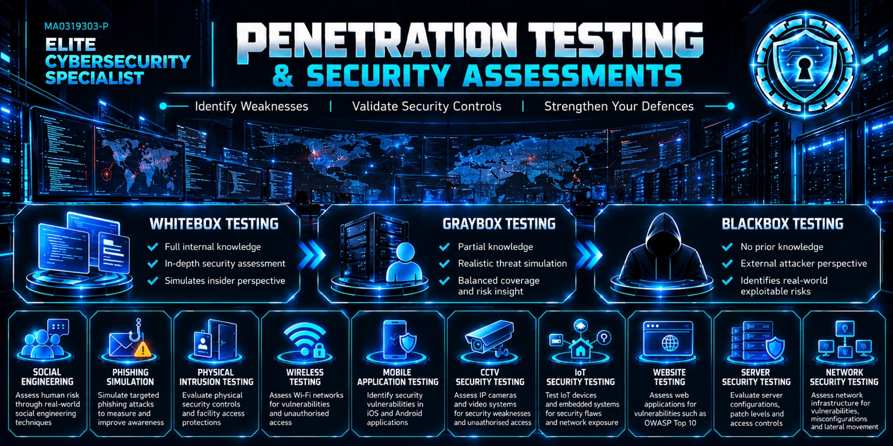
</p>

Building a hardened environment is only one side of cybersecurity. The other side is testing it. Our penetration-testing methodology evaluates systems from an attacker's perspective so weaknesses can be found before they are exploited in the real world.

**Testing is performed only against systems that the customer owns or has explicitly authorized for assessment.**

### Industry Penetration-Testing Practice

**Standard engagement flow:**

```text
Infrastructure / Software Installation
    → Penetration Test
    → Identify Vulnerabilities
    → Remediation
    → Final Penetration Test to Verify
    → Reporting
```

The first penetration test shows where the weaknesses are. Findings are then prioritized and remediated. A final penetration test verifies that the fixes actually work before the results are documented in the final report.

The report provides the customer with a clear record of what was tested, what was identified, the risk of each confirmed finding, what was corrected and what remains to be addressed.

### Black Box — Gray Box — White Box

| Testing Method | How It Works |
|---|---|
| **Black Box Testing** | Little or no internal information. Simulates an external attacker encountering the environment for the first time. |
| **Gray Box Testing** | Limited information or restricted access. Useful for realistic partially trusted, customer or user-level scenarios. |
| **White Box Testing** | Extensive internal knowledge, such as architecture details, approved credentials, configuration or source information, for deeper assessment. |

### Our Penetration-Testing Areas

| Testing Area | Customer-Facing Scope |
|---|---|
| Web Application Testing | Authentication, authorization, sessions, injection, input validation, security configuration and other OWASP-related risks. |
| API Security Testing | API authentication, authorization, endpoints, tokens, data exposure, rate controls and abuse paths. |
| Authentication & Access Control | Login security, controlled brute-force resistance, MFA, account lockout, sessions and privilege boundaries. |
| Server Security Testing | Exposed services, operating-system weaknesses, remote administration, configuration and privilege boundaries. |
| Network Penetration Testing | Ports, services, segmentation, firewall exposure, insecure protocols and unintended network access. |
| Wireless Security Testing | Authorized Wi-Fi environments, encryption, access controls, exposure and wireless attack paths. |
| Mobile Application Testing | Mobile application behavior, local storage, APIs, authentication and communications. |
| CCTV Security Testing | IP cameras, VMS/NVR platforms, authentication, APIs, remote access and network exposure. |
| IoT Security Testing | Connected devices, embedded systems, authentication, services, communications and supporting platforms. |
| Social Engineering Assessment | Authorized assessment of human security controls and whether staff can be manipulated into bypassing procedures. |
| Phishing Simulation | Controlled phishing exercises used to measure awareness, reporting and organizational response. |
| Physical Security Testing | Where formally authorized, controlled assessment of physical access controls that protect sensitive systems or facilities. |
| Vulnerability Validation | Confirm whether important scanner or assessment findings are real, exploitable and relevant to the customer environment. |
| Remediation & Re-Testing | Verify that corrective actions actually resolve the identified security weaknesses. |

### Threat-Informed Testing

Our assessment methodology can reference OWASP for web and application risks, MITRE ATT&CK for realistic attacker behavior, CIS and NIST for defensive controls, and DISA STIG / SRG principles for high-security hardening objectives.

> [!NOTE]
> **What matters:** The purpose is not to tick boxes. The purpose is to understand whether a real attacker can find a path through the environment, what that path could achieve, whether the weakness is real and whether the final fix actually stops it.

---

## University Seminars

<p align="center">
  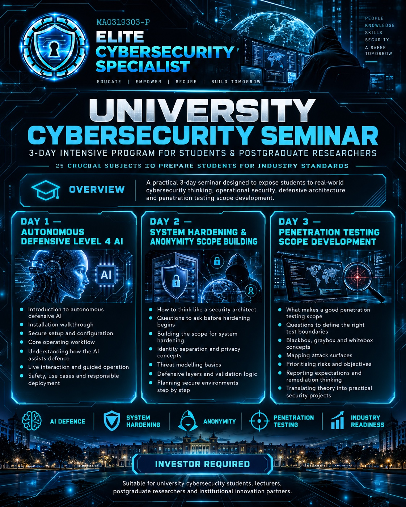
</p>

We plan to conduct a **3-day cybersecurity seminar covering 25 crucial subjects** designed to prepare university students for real industry standards, working practices and expectations. The seminar is intended to bridge the gap between academic learning and the way cybersecurity projects are actually scoped, operated and tested in the industry.

### Day 1 — Autonomous Defensive Level 4 AI

Students will interact directly with an Autonomous Defensive Level 4 AI. The session will take them from installation and setup through to operating and interacting with the system, so they can understand how an autonomous defensive AI observes conditions, evaluates risk and works inside a controlled cybersecurity environment.

### Day 2 — Building the Security Scope

Students will learn what questions to ask before working on a real environment. The focus is on building a proper scope for system hardening and anonymity: understanding the customer, the systems involved, what must remain available, what needs protection, what information is sensitive and where unnecessary exposure exists.

### Day 3 — Penetration Testing Scope & Industry Thinking

Students will learn how to build the scope for penetration testing, define authorized boundaries, understand what needs to be tested and connect the results back to remediation and defensive hardening. The aim is to teach students how to think about a cybersecurity engagement before they begin using tools.

Across the three days, the seminar will cover **25 crucial cybersecurity subjects**, selected to prepare students for practical industry expectations rather than purely academic theory.

**Investment status:** Investor required.

---

## Independent Self-Funded Research & Development

In addition to customer services, ELITE CYBERSECURITY SPECIALIST independently funds and develops experimental technology. These projects represent our longer-term research direction and are developed using our own resources.

### Perfect Charity System

**Progress: 20% — Self-Funded**

This is engineered to be the most transparent charity system ever built. Each individual will have a profile and donations are recorded using blockchain technology. Users can choose their own preferred payment gateway. Each donation is direct; these direct donations are not used to pay for expenses.

The logical flow is engineered to eliminate existing charity crimes. Once completed, our long-term goal is to pursue a world record for the transparency of the charity system.

### Discover New Species

**Progress: 10% — Self-Funded**  
**Investor required**

An AI analytic attachment for exploration drones to discover new species. Think of it as an attached brain for the drone that understands the database of mammals, birds and reptiles. Later upgrades are planned for trees, plants and other biological categories.

The AI is designed to compare what the drone sees against known species information and flag unusual observations for deeper investigation and expert verification.

### Battle Hardened AI

**Progress: 95% — Self-Funded**

The system operates at **Level 4 — Autonomous Decision AI** — autonomously computing, validating, calibrating and enforcing probabilistic security decisions within a unified reasoning architecture. It learns and recalibrates from observed outcomes while maintaining a controlled and deterministic enforcement model.

Six of eight Level 5 criteria are now met: self-governance, autonomous strategy adaptation, autonomous calibration refinement, self-evolving decision models, bounded autonomous authority, and improvement without manual rule creation are all operational. The system is actively advancing through the remaining two Level 5 requirements.

**Level 4 and Level 5 refer to our internal AI maturity model.**

### Battle Offensive AI

**Progress: 65% — Self-Funded**  
**Investor required**

An autonomous Level 4 AI built to perform penetration testing, especially for black-box environments. It thinks before it attacks and studies every response and potential possibility. The architecture is agentic: it observes, reasons about the next authorized test, studies the result and updates its understanding of the environment.

The project is intended **exclusively for authorized cybersecurity testing and research environments**.

---

## Our Working Method

We prefer a working cycle that customers can understand and that our engineers can verify at every stage.

```text
HARDEN → TEST → VALIDATE → REMEDIATE → RE-TEST → MAINTAIN
```

Security is not treated as a one-time installation. Every important change should be tested, verified and maintained.

---

## Security Guidelines & Industry Frameworks

Our work is informed by recognized cybersecurity standards, benchmarks and defensive frameworks. We do not blindly apply every control from every framework. Different operating systems, applications and environments require different approaches.

| Framework | How It Guides Our Work |
|---|---|
| CIS Controls & CIS Benchmarks | Secure configuration, account protection, software management, network security, logging, backups and service reduction. |
| DISA STIG / SRG Security Principles | High-security operating-system, firewall, DNS, VPN, web-server, authentication, audit and system-integrity objectives, adapted to the actual platform. |
| NIST Cybersecurity Framework 2.0 | Govern, Identify, Protect, Detect, Respond and Recover. |
| NIST SP 800-53 | Selected access-control, authentication, configuration, audit, communications and incident-response principles. |
| NIST Zero Trust SP 800-207 | Authenticate and authorize access instead of assuming trust based only on network location. |
| OWASP Top 10 | Major web-application security risks and defensive testing priorities. |
| OWASP ASVS | Deeper application-security verification requirements where appropriate. |
| OWASP API Security | API-specific authentication, authorization, data-access and abuse risks where APIs exist. |
| MITRE ATT&CK | Threat-informed understanding of realistic attacker techniques and possible attack paths. |
| NIST SSDF SP 800-218 | Secure software-development, dependency and deployment practices. |
| CISA Secure by Design | Reduce default exposure and build security into the architecture from the beginning. |
| ISO/IEC 27001 & 27002 Principles | Relevant organizational and information-security principles where appropriate to the customer environment. |

### DISA STIG / SRG-Aligned Defensive Hardening

Selected high-security principles are used for endpoint protection, private-server security, firewall policy, secure communications, authentication, auditing and system integrity. We adapt them to the actual platform rather than blindly applying incompatible remediation scripts.

**Framework alignment does not automatically mean formal certification.** Formal compliance or certification requires its own defined assessment and evidence process.

---

## Monitoring, Backup & Incident Response

Security does not end when deployment is completed. A protected environment requires continued maintenance, verification and a recovery path when something goes wrong.

| Control Area | Purpose |
|---|---|
| Monitoring | Security events, system health, application behavior and unexpected changes. |
| Integrity Review | Check whether critical configuration, files or services have changed unexpectedly. |
| Updates | Maintain operating systems, applications and dependencies with controlled security updates. |
| Encrypted Backups | Keep protected recovery material and configuration backups separate from the production environment. |
| Recovery Testing | Confirm that backups and rebuild procedures can actually restore the environment. |
| Incident Response | Contain compromise, revoke access, rotate credentials, preserve evidence and rebuild where necessary. |

---

## What Customers May Receive

**Architecture & Hardening:** Security architecture design, system hardening, High Security Laptop configuration, Ghost Connection privacy architecture, Custom Secure Android Phone configuration, private-server hardening, website defensive hardening and payment-environment security.

**Penetration Testing:** Authorized testing, vulnerability validation, remediation recommendations and final re-testing.

**Custom Secure Websites:** Security-first website development, hardened administration, payment integration, deployment hardening and penetration-test readiness for the agreed website scope.

**University Seminars:** Structured 3-day cybersecurity education covering Autonomous Defensive Level 4 AI, system-hardening and anonymity scope building, penetration-testing scope development and 25 crucial industry-focused subjects.

**Operations & Recovery:** Account-security guidance, monitoring design, backup planning, recovery planning and incident-response support where included in scope.

**Development & Documentation:** Cybersecurity system development and customer-facing security documentation for the agreed project scope.

---

## What We Do Not Publicly Expose

Customers should understand how their protection works. That does not mean every implementation detail should become public.

Sensitive engineering information can include firewall rule sets, infrastructure addresses, private keys, recovery information, account credentials, internal security exceptions, detailed vulnerability information, onion-service secrets, backup locations and internal hardening scripts.

> [!NOTE]
> **Protection of the blueprint:** The customer can understand the architecture in full without publishing the exact implementation details required to reproduce or attack it.

---

## Security Reality

No responsible cybersecurity company should promise that a system is impossible to hack. No responsible privacy engineer should promise that a person is impossible to identify under every possible circumstance.

Our objective is to reduce risk aggressively. We design environments to reduce attack surface, unnecessary exposure, weak authentication, infrastructure discovery, identity leakage, insecure configuration and single points of failure.

Security effectiveness also depends on customer behavior, operational discipline, third-party providers, physical control of devices and the absence of endpoint compromise.

---

## Connect with Elite Cybersecurity Specialist

**Yuhisern Navaratnam** — Cybersecurity Engineer  
**Elite Cybersecurity Specialist** | Malaysia  
**SSM:** 202403184091 (MA0319303-P)

<p align="center">
  <a href="https://raw.githubusercontent.com/elite-cybersecurity-specialist/battle-hardened-ai/main/assets/ECS_Digital_Name_Card_525x295.png">
    
  </a>
</p>

- **Email:** [Yuhisern@protonmail.com](mailto:Yuhisern@protonmail.com)
- **WhatsApp:** [+60 17-279 1717](https://wa.me/60172791717)
- **GitHub — Battle-Hardened AI:** [Official repository](https://github.com/elite-cybersecurity-specialist/battle-hardened-ai)
- **GitHub — Other Cybersecurity Projects:** [Elite Cybersecurity Specialist](https://github.com/elite-cybersecurity-specialist)
- **TikTok:** [@yuhisern](https://www.tiktok.com/@yuhisern)
- **LinkedIn:** [linkedin.com/in/yuhisern](https://www.linkedin.com/in/yuhisern)
- **X:** [x.com/yuhisern](https://x.com/yuhisern)

> [!NOTE]
> **HARDEN. TEST. VERIFY. IMPROVE.**  
> We do not focus on a single security product. We focus on the complete environment — from the device in the customer's hands to the connection, private infrastructure, website, payment environment and specialized cybersecurity systems behind it.

---

<sub>ELITE CYBERSECURITY SPECIALIST | Company Profile | October 2026. GitHub README edition. All 12 company profile illustrations are linked to files in company-profile-images/.</sub>

